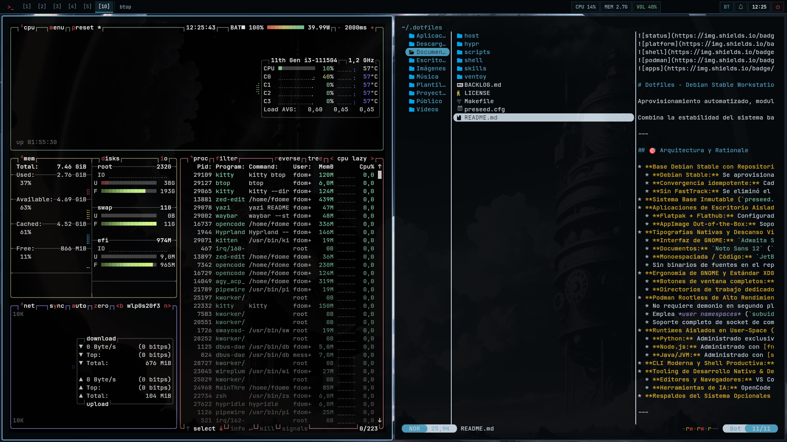

# Dotfiles - Debian Stable Workstation

Aprovisionamiento automatizado, modular e idempotente de una estación de trabajo de alto rendimiento para tareas de **ingeniería de software, DevOps e Inteligencia Artificial**, diseñada exclusivamente para **Debian Stable**. Cada ejecución converge el sistema al estado deseado y puede repetirse sin efectos secundarios.

Combina la estabilidad del sistema base con capas modernas desacopladas: **Backports** (en Stable), **Flatpak + Flathub**, soporte nativo para **AppImage** y contenedores **Podman Rootless** (`crun` + `pasta`/`passt`). Incluye además un **perfil opcional Hyprland** (`make hyprland`) que convive con **GNOME mínimo estándar** (`gnome-core`) como fallback limpio en GDM.

---



*Perfil Hyprland con Waybar, `yazi` y `btop` sobre el wallpaper de Mr. Robot.*

---

## 🎯 Arquitectura y Rationale

* **Base Debian Stable con Repositorios Extendidos:**
  * **Debian Stable:** Se aprovisiona con soporte extendido para kernels recientes vía **Debian Backports** (`stable-backports`), manteniendo la estabilidad de la base del sistema. El aprovisionamiento está diseñado y validado para **Debian Stable**; Testing/Forky no está soportado y el perfil Hyprland rechaza explícitamente sistemas que no sean Stable.
  * **Convergencia idempotente:** Cada ejecución de `make install` o `make host` deja Backports en su estado canónico (formato DEB822, `Signed-By` correcto y suite `stable-backports`), corrigiendo desviaciones sin duplicar configuración.
  * **Sin FastTrack:** Se eliminó el repositorio FastTrack del aprovisionamiento: ningún paquete lo requería y su presencia rompía la resolución de APT en suites no estables. Si un host conserva `/etc/apt/sources.list.d/debian-fasttrack.sources`, `make host` lo elimina automáticamente.
* **Manifiestos de Paquetes Desacoplados (`packages/`):**
  * Las listas declarativas viven en archivos planos dentro de `packages/` (`apt-base.txt`, `apt-optional.txt`, `apt-backports.txt`, `apt-hyprland.txt`, `flatpak.txt` y `external.txt`) leídos por `scripts/lib/packages.sh`, garantizando paridad exacta entre instalación (`host/setup.sh`, `scripts/hyprland.sh`, `scripts/tooling.sh`), actualización (`scripts/update.sh`) y verificación (`scripts/verify.sh`).
* **Sistema Base Inmutable (`preseed.cfg`):** Instalación desatendida con particionado GPT + EFI + EXT4 monolítico (`noatime,commit=60`), memoria comprimida ultra-rápida vía `systemd-zram-generator` (`zstd`, prioridad 100) respaldada por swapfile de 4 GB, microcódigo y firmware oficial completo para hardware **AMD e Intel** (CPU, GPU Vulkan/VA-API, Wi-Fi `iwlwifi`/`realtek`/`atheros`, audio SOF) y entorno mínimo `gnome-core` estándar (sin extensiones ni personalizaciones extra).
* **Aplicaciones de Escritorio Aisladas (Flatpak & AppImage):**
  * **Flatpak + Flathub:** Configurado de forma nativa (`gnome-software-plugin-flatpak`, `xdg-desktop-portal-gnome` y remote `flathub`) para aislar completamente las aplicaciones de consumo general del sistema base.
  * **AppImage Out-of-the-Box:** Soporte FUSE 2 y FUSE 3 garantizado mediante `libfuse2t64` y `fuse3`, con directorio dedicado `~/Aplicaciones` integrado directamente en el `$PATH` del usuario.
* **Tipografías Debian y Cursor en Hyprland:**
  * **Escritorio / UI:** `Inter` (`fonts-inter`, empaquetada en Debian Stable main; legibilidad óptima en interfaces, paneles GTK/Qt6, Waybar, Fuzzel, SwayNC y Quickshell en `cyber-teal`).
  * **Documentos:** `Atkinson Hyperlegible` (`fonts-atkinson-hyperlegible`, diseñada para máxima legibilidad y descanso visual en lectura).
  * **Código / Terminal:** `JetBrains Mono` (`fonts-jetbrains-mono`, en Foot, Neovim, Zed, Zathura y el tema HUD monoespaciado `mr-robot`).
  * **Cursor:** `Bibata-Modern-Classic` 24 px (`bibata-cursor-theme`) exclusivo para Hyprland; GNOME Shell permanece en su configuración estándar por defecto como fallback en GDM.
  * Sin fuentes de texto externas ni binarios de fuentes en el repo git: todas las tipografías de texto provienen de paquetes APT oficiales de Debian (`Symbols Nerd Font` se descarga aparte únicamente para glifos/iconos de Waybar y menús).
* **Directorios de Trabajo XDG:**
  * Crea y registra `~/Proyectos` (`XDG_PROJECTS_DIR`) y `~/Aplicaciones` (`XDG_APPLICATIONS_DIR`) en `~/.config/user-dirs.dirs`, con aliases rápidos en Zsh (`pdir` y `adir`).
* **Podman Rootless de Alto Rendimiento:** Motor de contenedores OCI sin demonio (daemonless) ejecutándose en espacio del usuario:
  * No requiere demonio en segundo plano (`dockerd`) ni privilegios de superusuario (`sudo`).
  * Emplea *user namespaces* (`subuid`/`subgid`), runtime OCI rápido **`crun`** y el motor de red de alto rendimiento **`pasta` (`passt`)** preconfigurado en `~/.config/containers/containers.conf`.
  * Soporte completo de socket de compatibilidad Docker vía `systemd --user` (`podman.socket`) y aliases de conveniencia (`docker`, `d`, `podman compose`, `dc`).
* **Runtimes Aislados en User-Space (PEP 668 Compliant):**
  * **Python:** Administrado exclusivamente con [uv](https://astral.sh/uv) (rápido, compatible con PEP 668 y sin riesgo de corromper paquetes de Debian).
  * **Node.js:** Administrado con [fnm](https://github.com/Schniz/fnm) (Fast Node Manager escrito en Rust).
  * **Java/JVM:** Administrado con [sdkman](https://sdkman.io).
* **CLI Moderna y Shell Productiva:** `ripgrep` (`rg`), `fd-find` (`fd`), `fzf`, `bat`, `btop`, `direnv` y `wl-clipboard`, gestor de archivos en terminal [yazi](https://github.com/sxyazi/yazi) (con previews Sixel en Foot y wrapper `y`), más `zoxide` (`z`/`zi`), `atuin` (historial con `Ctrl+R`), `starship` (prompt) y `tmux` (sesiones persistentes, `Super+Shift+Return`).
* **Tooling de Desarrollo Nativo & DevAI:**
  * **Editores y Navegadores:** Brave Browser (navegador predeterminado con soporte nativo para Web Apps/PWAs y repositorio oficial APT DEB822), Google Chrome oficial, Firefox (Flatpak), VS Code (con repositorio oficial APT DEB822 de Microsoft), Zed editor y Neovim (editor extensible en terminal con lazy.nvim, LSP y Treesitter).
  * **Herramientas de IA:** OpenCode CLI, Antigravity IDE (Core 2.0 en `/opt`) y Antigravity CLI (`agy` / `antigravity-cli`).
* **Respaldos del Sistema Opcionales (`make timeshift`):** Deja preconfigurado `/etc/timeshift/timeshift.json` (modo RSYNC en EXT4 o BTRFS, excluyendo `/home`, `/swapfile` y cachés de contenedores) sin forzar snapshots automáticos iniciales.

---

## 💿 Fase 0: Instalación Desatendida de Debian (`preseed.cfg`)

El archivo [`preseed.cfg`](preseed.cfg) automatiza la instalación limpia de Debian Stable. Por seguridad, las credenciales sensibles están parametrizadas con placeholders:

1. **Reemplazar placeholders locales antes de inyectar en el instalador/USB:**
   * `<WIFI_SSID>` y `<WIFI_PASSWORD>`: Nombre y clave WPA de tu red Wi-Fi.
   * `<PASSWORD_HASH_SHA512>`: Hash de tu contraseña de usuario generado con:
     ```bash
     openssl passwd -6
     ```
   * En `preseed.cfg`, la suite de instalación está fijada en `stable`.

---

## 🚀 Fase 1: Post-Instalación Rápida (One-Command)

En una instalación limpia de Debian ejecutar:

```bash
sudo apt update && sudo apt install -y git make && \
rm -rf ~/.dotfiles && \
git clone https://github.com/fdomerlo/dotfiles.git ~/.dotfiles && \
cd ~/.dotfiles
make help
```

---

## 📂 Estructura del Repositorio

```text
~/.dotfiles/
├── Makefile                       # Orquestador modular (install, update, host, hypr-desktop, hypr-laptop, etc.)
├── preseed.cfg                    # Instalador desatendido Debian Stable (AMD/Intel)
│
├── assets/                        # Capturas usadas en la documentación
│   └── hyprland-desktop.png       #   Vista previa del perfil Hyprland
│
├── packages/                      # Manifiestos planos de paquetes (SSOT)
│   ├── apt-base.txt               #   Paquetes base Debian Stable main (host/setup.sh + update.sh)
│   ├── apt-optional.txt           #   Paquetes opcionales/externos actualizados solo si están instalados
│   ├── apt-backports.txt          #   Stack Hyprland provisto desde stable-backports
│   ├── apt-hyprland.txt           #   Utilidades del perfil Hyprland en Debian Stable main
│   ├── flatpak.txt                #   Suite de aplicaciones Flatpak (Flathub)
│   └── external.txt               #   Inventario de herramientas binarias y recursos externos
│
├── host/                          # Configuración del sistema base (requiere sudo en setup/timeshift)
│   ├── podman.sh                  #   Configuración de Podman Rootless (crun, pasta) y socket (usuario)
│   ├── setup.sh                   #   Configuración de APT (Backports), paquetes base y podman
│   └── timeshift.sh               #   Configuración opcional de snapshots Timeshift
│
├── hypr/                          # Perfil opcional Hyprland (no reemplaza GNOME)
│   ├── hyprland.conf              #   Entrada principal; incluye conf/*.conf (incl. plugins.conf) y local.conf
│   ├── conf/                      #   env, monitors, workspaces, appearance, keybinds, windowrules, plugins, autostart
│   │   └── profiles/              #     Plantillas multi-estación (desktop.conf, laptop.conf)
│   ├── fontconfig/                #   Alias Fontconfig para Debian (Inter, Atkinson Hyperlegible, JetBrains Mono)
│   ├── hypridle.conf              #   Bloqueo y apagado de pantalla por inactividad
│   ├── hyprlock.conf              #   Pantalla de bloqueo
│   ├── foot/                      #   Emulador de terminal Wayland (foot.ini)
│   ├── fuzzel/                    #   Lanzador y selector dmenu nativo (fuzzel.ini)
│   ├── qt6ct/                     #   Semilla inicial de tema oscuro Qt6 (qt6ct.conf)
│   ├── quickshell/                #   Overview e indicador de wallpaper (shell.qml, OverviewWindow.qml, WallpaperBadge.qml, qmldir)
│   ├── swappy/                    #   Anotador rápido de capturas (config)
│   ├── swaync/                    #   Centro de notificaciones (config.json + style.css)
│   ├── scripts/                   #   menú maestro, Web Apps, session-gsettings, wallpaper, workspaces, overview, station-profile, VPN, capturas y atajos
│   ├── themes/                    #   Variantes visuales (mr-robot, cyber-teal) + symlink active
│   ├── waybar/                    #   Barra (config.jsonc + style.css, incluye ~/.config/waybar/local.jsonc)
│   └── xdg-desktop-portal/        #   Portal específico de Hyprland (hyprland-portals.conf)
│
├── scripts/                       # Instaladores y configuración de usuario
│   ├── lib/packages.sh            #   Parser compartido para manifiestos en packages/
│   ├── antigravity.png            #   Icono oficial para el lanzador .desktop
│   ├── apt-maintenance.sh         #   Higiene APT (podman-only, DEB822, deduplicación y keyrings)
│   ├── clean-system.sh            #   Limpieza profunda post-upgrade (purga rc, huérfanos, cachés y logs)
│   ├── desktop.sh                 #   Carpetas Proyectos/Aplicaciones y limpieza hacia GNOME Shell estándar
│   ├── devai.sh                   #   Instalador de OpenCode CLI, Antigravity CLI y Core/IDE
│   ├── devtools.sh                #   Instalador de gh (binario oficial), uv, fnm, sdkman, yazi y mc
│   ├── hyprland.sh                #   Instalador del perfil opcional Hyprland (solo Debian Stable)
│   ├── hyprland-packages.sh       #   Shim compatible que carga packages/apt-{backports,hyprland}.txt y binarios
│   ├── hyprland-refresh.sh        #   Re-sincroniza configs/scripts desde el repo y recarga la sesión
│   ├── ohmyzsh.sh                 #   Instalación de Zsh, Oh My Zsh y plugins
│   ├── setup_agy.sh               #   Despliegue atómico de Antigravity Core/IDE en /opt (opcional)
│   ├── setup_gh.sh                #   Configuración y autenticación SSH con GitHub CLI
│   ├── setup_git.sh               #   Configuración idempotente de identidad Git en ~/.config/git/local.gitconfig
│   ├── tooling.sh                 #   Instalación de Brave (APT DEB822, default), Chrome (.deb), VS Code, Zed, Neovim y Flatpak
│   ├── update.sh                  #   Actualización idempotente (only-upgrade desde manifiestos + gh/user-space + flatpak)
│   └── verify.sh                  #   Diagnóstico y validación post-instalación
│
└── shell/                         # Dotfiles y utilitarios de línea de comandos
    ├── atuin.toml                 #   Historial de comandos (Atuin)
    ├── btop/                      #   Config base y tema neutro de btop
    │   ├── btop.conf              #     Semilla de configuración (copia única)
    │   └── themes/neutral.theme   #     Paleta de acero/grises, fondo transparente
    ├── nvim/                      #   Configuración modular de Neovim (init.lua, lazy.nvim, LSP, Treesitter)
    │   ├── init.lua               #     Bootstrap de lazy.nvim y carga de módulos
    │   └── lua/                   #     options, keymaps, autocmds y plugins declarativos
    ├── yazi/                      #   Gestor de archivos en terminal
    │   ├── yazi.toml              #     Layout de tres paneles, previews y openers
    │   ├── keymap.toml            #     Atajos F2/F5/F6/F7/F8, pestañas y navegación
    │   └── theme.toml             #     Paleta Nord de alto contraste para lectura
    ├── mc/                        #   Midnight Commander (alternativa de dos paneles)
    │   ├── ini                    #     Config base: skin Nord y sin autoguardado
    │   ├── mcedit.desktop         #     Override para ocultar el editor duplicado en fuzzel
    │   └── skins/nord.ini         #     Skin truecolor Nord (misma paleta que Yazi)
    ├── zathura/                   #   Visor de documentos PDF minimalista (zathurarc)
    ├── lazydocker/                #   TUI de contenedores Podman/Docker (config.yml + .desktop)
    ├── devctl                     #   CLI de diagnóstico, actualización y limpieza
    ├── gitconfig                  #   Configuración global ergonómica de Git (incluye ~/.config/git/local.gitconfig)
    ├── starship.toml              #   Prompt minimalista de una línea (directorio + Git)
    ├── tmux.conf                  #   Sesiones y splits de tmux
    └── zshrc                      #   Configuración Zsh con uv, fnm, sdkman, fzf, direnv, XDG y Podman
```

---

## 🛠️ Makefile Targets

| Target | Descripción |
| :--- | :--- |
| `make install` | Aprovisionamiento completo (host + podman + shell + devtools + tooling + devai + desktop) |
| `make full-install` | Aprovisionamiento completo con Timeshift y Hyprland |
| `make update` | Actualización idempotente (higiene APT + only-upgrade desde `packages/` + user-space + `gh` + flatpak, sin tocar SSH/`gh auth`) |
| `make refresh` | Re-sincroniza configs/scripts de Hyprland desde el repo y recarga Hyprland, Waybar, Quickshell, swaync e hypridle (sin instalar paquetes) |
| `make host` | Configura APT (Backports), CLI moderna, AppImage, Flatpak y Podman |
| `make timeshift` | *(Opcional)* Instala y configura `/etc/timeshift/timeshift.json` sin crear snapshots iniciales |
| `make podman` | Configura Podman en modo Rootless con backend pasta (systemd --user) |
| `make shell` | Instala Zsh, Oh My Zsh, plugins y enlaza `.zshrc`, `.gitconfig`, `devctl`, `btop`, `yazi` y `nvim` |
| `make devtools` | Instala `gh`, `uv`, `fnm`, `sdkman`, `yazi`, prepara SSH con GitHub e identidad Git local |
| `make gitconfig` | Configura `user.name` y `user.email` en `~/.config/git/local.gitconfig` sin modificar el repo |
| `make github-auth` | Flujo interactivo oficial de autenticación en GitHub CLI (`gh auth login`) |
| `make tooling` | Instala navegadores, editores y suite sysadmin/productividad (Brave por defecto, Chrome, Firefox, LibreOffice, VS Code, Zed, Neovim, Remmina, Wireshark, DBeaver, Bruno, Obsidian, Super Productivity) |
| `make devai` | Instala OpenCode CLI, Antigravity CLI y despliega Antigravity Core/IDE (opcional) |
| `make desktop` | Mantiene GNOME Shell estándar (sin extensiones ni overrides extra) y directorios de trabajo |
| `make hyprland` | *(Opcional)* Instala y configura el perfil Hyprland sin reemplazar GNOME (solo Debian Stable) |
| `make hypr-desktop` | Aplica la plantilla local de estación desktop en `~/.config/hypr/conf/local.conf` (con respaldo previo) |
| `make hypr-laptop` | Aplica la plantilla local de estación notebook en `~/.config/hypr/conf/local.conf` (con respaldo previo) |
| `make verify` | Ejecuta el test integral de salud del sistema |
| `make clean` | Limpia paquetes residuales de APT y directorios temporales |
| `make clean-deep` | Limpieza profunda post-upgrade: purga configs residuales (`rc`), dependencias huérfanas, journals y cachés |

---

## 🪟 Perfil opcional Hyprland

`make hyprland` instala un escritorio Wayland completo **sin reemplazar GNOME** y **solo sobre Debian Stable**. GNOME sigue siendo el fallback estándar y puede elegirse en GDM en cualquier momento.

```bash
make host       # asegura Backports de Stable (requerido)
make hyprland   # instala el stack e enlaza la configuración
```

El script aborta si el sistema no es Debian Stable o si falta `/etc/apt/sources.list.d/debian-backports.sources`.

### Componentes

| Función | Paquete / Herramienta |
| :--- | :--- |
| Compositor | `hyprland` (desde `stable-backports`) |
| Barra | `waybar` |
| Lanzador y menú | `fuzzel` (nativo Wayland, tematizado en `mr-robot` y `cyber-teal`) + Menú Maestro (`main-menu.sh`) |
| Overview (Activities) | `quickshell` (desde `stable-backports`: grilla de workspaces + previews en vivo + filtro + badge del wallpaper) |
| Notificaciones | `sway-notification-center` (`swaync`) con historial y No molestar |
| OSD | `swayosd` para volumen y brillo (respaldo directo con `wpctl`/`brightnessctl`) |
| Idle / bloqueo | `hypridle` + `hyprlock` |
| Wallpaper | `swaybg` (con rotación vía `wallpaper.sh` e indicador en `quickshell`) |
| Agente polkit | `hyprpolkitagent` |
| Keyring / Secretos | `gnome-keyring` + `seahorse` + `ssh-agent.socket` |
| Portales | `xdg-desktop-portal-hyprland` + `xdg-desktop-portal-gtk` (fallback) |
| Capturas y anotación | `grim` + `slurp` + `swappy` |
| Grabación de pantalla | `wf-recorder` (indicador `REC` en Waybar) |
| Búsqueda de archivos | `fd-find` + `fuzzel --dmenu` (abre el elegido con `xdg-open`) |
| Selector de color | `hyprpicker` (copia el color del píxel al portapapeles) |
| OCR de pantalla | `tesseract-ocr` + `tesseract-ocr-spa` + `grim` + `slurp` + `wl-copy` |
| Luz nocturna | `hyprsunset` (filtro de luz azul, toggle + indicador) |
| Calculadora | `gnome-calculator` |
| Visores nativos | `zathura` + `zathura-pdf-poppler` (PDFs) + `imv` (imágenes Wayland) |
| Portapapeles | `wl-clipboard` + `cliphist` |
| Audio / brillo / media | `wpctl` (PipeWire/WirePlumber), `brightnessctl`, `playerctl` |
| Terminal / archivos | `foot` (con `foot --server`) / `nautilus` (gráfico) + `yazi` (terminal, Sixel vía `chafa`) + `mc` |
| Contenedores / Sysadmin | `lazydocker` (TUI sobre socket Podman), `remmina` (RDP/VNC), `wireshark` (sin root), OpenVPN/WireGuard (`network-manager-openvpn`) |
| Navegadores / Flatpak | `Brave Browser` (predeterminado), `Google Chrome`, `Firefox` (Flatpak), `LibreOffice`, `DBeaver Community`, `Bruno`, `Obsidian`, `Super Productivity` |
| Web Apps (PWAs) | `hypr/scripts/webapp-install.sh` (`devctl webapp`): lanzadores `--app` con Brave/Chrome, favicon automático y reglas `float`/`scratchpad` |
| Previews de Yazi | `fd-find` (como `fd`), `7zip`, `ffmpeg`, `chafa`, `poppler-utils`, `jq` |
| Tema | `Inter` (UI, `fonts-inter`), `Atkinson Hyperlegible` (documentos), `JetBrains Mono` (código/terminal), cursor `Bibata-Modern-Classic` (`bibata-cursor-theme`), `qt6ct` |

En Stable, la lista declarada en [`packages/apt-backports.txt`](packages/apt-backports.txt) se instala con `-t stable-backports`; el resto proviene de [`packages/apt-hyprland.txt`](packages/apt-hyprland.txt) en Stable main.

### Atajos principales

| Atajo | Acción |
| :--- | :--- |
| `Super+Return` | Terminal (`foot`) |
| `Super+Shift+Return` | Terminal con `tmux` (sesión `main` persistente) |
| `Super` | Abrir/cerrar el lanzador (`fuzzel`) |
| `Super+D` / `Super+Space` | Lanzador de aplicaciones (`fuzzel`, alterna) |
| `Super+Alt+Space` | Menú Maestro jerárquico (Capturar, Estilo, Sistema, Dev & IA, Web Apps / PWAs) |
| `Super+A` | Overview tipo Activities (`quickshell`, grilla de workspaces + previews en vivo + filtro + navegación con `Tab`/`Shift+Tab`) |
| `Super+B` | Navegador predeterminado (`brave-browser`) |
| `Super+E` | Gestor de archivos gráfico (`nautilus`) |
| `Super+Y` | Gestor de archivos en terminal (`yazi` en `foot`) |
| `Super+W` | Cambiar el wallpaper (aleatorio, sin repetir el actual) |
| `Super+=` | Calculadora (`gnome-calculator`) |
| `Super+Ctrl+F` | Buscar archivos (`fd` + `fuzzel`, abre el elegido con `xdg-open`) |
| `Super+Shift+P` | Selector de color (`hyprpicker` copia el HEX al portapapeles) |
| `Super+Ctrl+O` | OCR de región (`slurp` + `tesseract` copia el texto al portapapeles) |
| `Super+Ctrl+N` | Luz nocturna on/off (filtro de luz azul de `hyprsunset`) |
| `Super+Shift+R` | Grabar/detener el monitor enfocado (`wf-recorder`, indicador `REC` en Waybar) |
| `Super+Q` | Cerrar ventana |
| `Super+F` | Pantalla completa |
| `Super+M` | Maximizar / restaurar |
| `Super+Shift+Space` | Alternar flotante |
| `Super+L` | Bloquear sesión (`hyprlock`) |
| `Alt+Tab` / `Alt+Shift+Tab` | Siguiente / anterior ventana |
| ``Alt+` `` | Volver a la ventana anterior |
| ``Super+` `` | Abrir/cerrar scratchpad (terminal flotante) |
| ``Super+Shift+` `` | Mover la ventana actual al scratchpad |
| `Super+G` | Crear/deshacer grupo de ventanas |
| `Super+Tab` / `Super+Shift+Tab` | Ciclar ventanas del grupo |
| `Super+Ctrl+G` / `Super+Shift+G` | Mover ventana al grupo / sacarla del grupo |
| `Super+N` / `Super+Shift+N` | Centro de notificaciones / No molestar |
| `Super+Shift+T` | Intercambiador de temas (Mr. Robot / Cyber-Teal) |
| `Super+F1` | Cheatsheet de atajos activos (teclado + mouse) |
| `Super+V` / `Super+Shift+V` | Historial de portapapeles (`cliphist` + `fuzzel`, alterna) |
| `Print` | Captura de región + anotación rápida en `swappy` + portapapeles |
| `Ctrl+Print` | Captura de región directa a archivo + portapapeles (sin abrir `swappy`) |
| `Shift+Print` | Captura de pantalla completa a archivo + portapapeles |
| `Super+1..0` / `Super+Shift+1..0` | Ir al workspace / mover ventana sin seguirla (también con el teclado numérico); `1-5` en el primer monitor y `6-0` en el segundo |
| `Super+Av.Pág` / `Super+Re.Pág` | Ciclar al workspace siguiente/anterior cubriendo todos los monitores (con wrap) |
| `Super+Shift+Av.Pág` / `Super+Shift+Re.Pág` | Mover la ventana al workspace siguiente/anterior cubriendo todos los monitores (con wrap) |
| `Super+flechas` / `Super+Shift+flechas` | Foco / mover ventana |
| `Super+Ctrl+flechas` | Redimensionar ventana |
| `Super+Click Izq.` / `Super+Click Der.` | Mover / redimensionar ventana desde la esquina más cercana (también arrastre en borde con `hover_icon_on_border`) |
| `Super+Alt+Click Izq.` | Redimensionar ventana con un solo botón (cómodo en touchpads) |
| `Super+Click Medio` | Alternar ventana flotante / mosaico |
| `Super+Rueda ↑/↓` | Ciclar workspaces entre monitores |
| `XF86Audio*` / `XF86MonBrightness*` | Volumen, mute, multimedia y brillo (con OSD) |

#### Yazi (terminal)

`Super+Y` abre Yazi en Foot. Los atajos tipo GUI se suman a los nativos (`hjkl`, `s`, `S`, `d`, `r`, `w`, `t t`, `o`/`O`).

| Atajo | Acción |
| :--- | :--- |
| `Enter` | Entrar al directorio o abrir el archivo |
| `F3` | Abrir con el opener por defecto (Zed para carpetas) |
| `F4` | Abrir con... (elige entre Neovim, nano, Zed, VS Code) |
| `F2` | Renombrar (cursor antes de la extensión) |
| `F5` / `F6` / `p` | Copiar / cortar / pegar |
| `F7` / `Ctrl+N` | Nueva carpeta / nuevo archivo |
| `F8` / `d` | Mover a la papelera |
| `Ctrl+T` / `Ctrl+W` | Nueva pestaña / cerrar pestaña |
| `Alt+Left` / `Alt+Right` / `Alt+Up` | Atrás / adelante / carpeta padre |
| `s` / `S` | Buscar por nombre (`fd`) / por contenido (`rg`) |
| `z` / `Z` | Saltar con `fzf` / con `zoxide` |
| `Ctrl+H` / `Ctrl+L` | Mostrar u ocultar ocultos / ir a una ruta |
| `Espacio` / `v` / `r` | Seleccionar / modo visual / renombrado masivo |
| `m s` / `m m` | Ver tamaño / fecha de modificación |
| `w` | Gestor de tareas (copias, movimientos, extracciones) |

#### Midnight Commander (terminal)

Alternativa clásica de dos paneles. Se abre escribiendo `mc` en cualquier terminal. Usa el skin Nord (`shell/mc/skins/nord.ini`) y el editor interno.

| Atajo | Acción |
| :--- | :--- |
| `F3` / `F4` | Ver / editar con el editor interno |
| `F5` / `F6` / `F8` | Copiar / mover / borrar |
| `F7` / `Alt+F7` | Crear directorio / buscar archivos |
| `F9` / `F10` | Menú superior / salir |
| `Alt+.` | Mostrar u ocultar archivos ocultos |
| `Tab` / `Insert` | Cambiar de panel / seleccionar |
| `Ctrl+O` | Mostrar la terminal y volver |

### Sesión, portal, seguridad y theming

* **Display manager:** GDM detecta automáticamente `/usr/share/wayland-sessions/hyprland.desktop`. No se instala `sddm`, `greetd` ni `uwsm`.
* **Agente polkit:** `hyprpolkitagent` se inicia desde `autostart.conf` solo dentro de Hyprland; no se habilita globalmente para no interferir con el agente de GNOME.
* **Keyring, SSH y secretos locales:**
  * `autostart.conf` activa vía `systemd --user` los servicios `gnome-keyring-daemon.service` (secretos/PKCS11 desbloqueados por PAM/GDM) y `ssh-agent.socket` (`/run/user/$UID/openssh_agent`), exportando `SSH_AUTH_SOCK`, `PATH` y `QT_QPA_PLATFORMTHEME` con `dbus-update-activation-environment --systemd`. No se lanza `gnome-keyring-daemon --start` manualmente para evitar instancias duplicadas.
  * **Identidad Git desacoplada:** [`shell/gitconfig`](shell/gitconfig) incluye `~/.config/git/local.gitconfig` (archivo local no versionado). `make shell`, `make gitconfig` y `setup_gh.sh` migran o escriben `user.name`/`user.email` exclusivamente en ese archivo local sin ensuciar el repositorio.
  * **Tokens y credenciales:** los tokens de `gh` (`~/.config/gh/hosts.yml`), credenciales de OpenCode/Antigravity y secretos VPN (gestionados por NetworkManager/Keyring; `network-menu.sh` soporta OpenVPN + WireGuard y abre `foot` con `nmcli --ask` si la conexión requiere contraseña o 2FA interactivo) residen fuera del repositorio Git.
* **Waybar:** se lanza con `hypr/scripts/start-waybar.sh`, que espera los sockets IPC de Hyprland antes de iniciar la barra para evitar la carrera de arranque de `exec-once`. El `waybar.service` que Debian habilita por defecto se enmascara porque `graphical-session.target` lo arranca en GNOME, donde falla al no existir `wlr-layer-shell`. Cada tema incluye `~/.config/waybar/local.jsonc` (sembrado con `{}` si no existe) para personalizar módulos por equipo sin tocar archivos versionados.
* **Iconos de Waybar:** `style.css` usa `Symbols Nerd Font` únicamente para los glifos/iconos de los módulos. Debian no empaqueta Nerd Fonts, así que `scripts/hyprland.sh` descarga el paquete de símbolos `NerdFontsSymbolsOnly` en `~/.local/share/fonts` si no está presente; todas las tipografías de texto (UI, documentos y código) provienen exclusivamente de paquetes oficiales de Debian.
* **Overview (Quickshell):** `autostart.conf` inicia `qs -n -d` en segundo plano con la configuración en `~/.config/quickshell/` (`hypr/quickshell/`). `Super+A` (y el gesto de 3 dedos hacia abajo en touchpad) llama a `hypr/scripts/overview-toggle.sh`, que abre/cierra la vista por IPC (`qs ipc call overview toggle`). Muestra una grilla por monitor con los workspaces, miniaturas en vivo (`ScreencopyView`) y barra de búsqueda de ventanas abiertas en el monitor enfocado: `Tab` / `Shift+Tab` recorre cíclicamente los workspaces de todos los monitores (y `Enter` salta al seleccionado); si escribís un filtro sin usar `Tab`, `Enter` salta a la primera ventana coincidente; `Esc` o clic afuera cierra.
* **Screen sharing:** `xdg-desktop-portal-hyprland` provee `hyprland.portal` con `UseIn=Hyprland`, por lo que se selecciona solo dentro de la sesión. `xdg-desktop-portal-gtk` cubre el file picker y aplicaciones GTK.
* **`XDG_CURRENT_DESKTOP`:** se define como `Hyprland:GNOME` en `env.conf` de forma intencional, para que los portales de GNOME cubran file picker y secretos. Por eso `appearance.conf` activa `misc:disable_xdg_env_checks`, que silencia el aviso de Hyprland sobre entornos «gestionados externamente».
* **Portal (`hyprland-portals.conf`):** como `XDG_CURRENT_DESKTOP` incluye `GNOME`, `xdg-desktop-portal` intentaba usar `gnome.portal` para las interfaces que `hyprland.portal`/`gtk.portal` no implementan. Ese backend no existe en Hyprland y el portal quedaba bloqueado esperando timeouts de D-Bus; como consecuencia `org.freedesktop.portal.Settings` no respondía y Waybar se quedaba esperando el esquema de color sin dibujarse. `hypr/xdg-desktop-portal/hyprland-portals.conf` fija `default=hyprland;gtk`, mantiene `Secret=gnome-keyring` y desactiva con `none` las interfaces exclusivas de GNOME. El nombre `hyprland-portals.conf` es intencional: xdg-desktop-portal solo lo aplica cuando `XDG_CURRENT_DESKTOP` contiene `Hyprland`; en GNOME usa `gnome-portals.conf` del sistema.
* **Ciclo de sesión y aislamiento respecto a GNOME:** `autostart.conf` inicia `graphical-session.target` y ejecuta `hypr/scripts/session-gsettings.sh apply` (modo oscuro, `Inter` para UI, `Atkinson Hyperlegible` para documentos, `JetBrains Mono` para código y `Bibata-Modern-Classic` para cursor). Al salir de Hyprland, `exec-shutdown` ejecuta `session-gsettings.sh reset` y detiene `graphical-session.target`, devolviendo GSettings y portales al estado estándar de GNOME para que el fallback en GDM permanezca intacto.
* **Mouse avanzado y plugins (`hypr/conf/plugins.conf`):** concentra la ergonomía nativa de ventanas con mouse (`resize_on_border`, `extend_border_grab_area = 15`, `hover_icon_on_border`, `binds:drag_threshold = 10`, `Super+Alt+Drag`, `Super+Click Medio` y `Super+Rueda`) y deja preparada la configuración de `hyprbars` documentada y comentada mientras la ABI de `hyprland-plugin-hyprbars` en `stable-backports` (`0.53.0`) no coincida con `hyprland` (`0.55.2`).
* **Teclado y Qt6ct:** layout `latam` (`pc105`), consistente con `preseed.cfg`. `make hyprland` y `make refresh` siembran `~/.config/qt6ct/qt6ct.conf` (Fusion + paleta oscura + `Inter` UI + `JetBrains Mono` fijo) solo si no existe, permitiendo personalizaciones locales en Qt6.
* **Cursor y Fontconfig en Hyprland:** `Bibata-Modern-Classic` 24 px (`bibata-cursor-theme`) en Hyprland, XWayland, GTK y Qt (`env.conf` fija `XCURSOR_THEME`/`HYPRCURSOR_THEME`, `settings.ini` de GTK fija `gtk-cursor-theme-name` + `gtk-font-name = Inter 11` y `session-gsettings.sh` actualiza los portales en caliente). `hypr/fontconfig/10-hyprland-fonts.conf` se enlaza en `~/.config/fontconfig/conf.d/` para preferir `Inter`, `Atkinson Hyperlegible` y `JetBrains Mono` sin instalar tipografías de texto fuera de Debian.
* **Monitores y perfiles multi-estación (`local.conf`):** `hypr/conf/monitors.conf` fija el layout base (`HDMI-A-1` en `0x0`, `HDMI-A-2` en `auto-right`, escala `1` y fallback `,preferred,auto,1`). Para convivir sin conflictos entre escritorio y notebooks, `hyprland.conf` carga al final `~/.config/hypr/conf/local.conf` (no versionado). Cuando no existe, `make hyprland` y `make refresh` ejecutan `hypr/scripts/station-profile.sh apply auto` para detectar batería/DMI y sembrarlo desde `hypr/conf/profiles/desktop.conf` o `laptop.conf` (o podés forzarlo con `make hypr-desktop` / `make hypr-laptop` con respaldo automático `.bak.<timestamp>`). Ver salidas con `hyprctl monitors`.
* **Escalado por monitor (DPI):** la escala de Hyprland es un zoom lógico por salida, no un ajuste automático de densidad. La configuración portable es escala `1` en todas las salidas; `hypr/scripts/monitor-scale.sh` sigue disponible para casos puntuales calculando PPI lógico desde `hyprctl monitors -j`. No conviene fijar `GDK_SCALE`, `GDK_DPI_SCALE` ni `QT_SCALE_FACTOR` globales: pisan el escalado por salida.
* **Workspaces:** `hypr/scripts/workspaces-init.sh` (lanzado por `autostart.conf` con `--watch`) asigna **5 workspaces por salida conectada**, en orden izquierda→derecha según su `x`: `1–5` al primero y `6–10` al segundo. Con un solo monitor eso da `1–5` en `eDP-1`; con dos, `1–5` en `HDMI-A-1` y `6–10` en `HDMI-A-2`. Los aplica en caliente con `hyprctl keyword workspace` y `persistent:true`, así Hyprland los mantiene vivos y Waybar muestra solo los de su salida (`all-outputs: false`). Para recorrerlos, `Super+Av.Pág`/`Super+Re.Pág` (y `Super+Rueda`) ciclan a través de todos los monitores con wrap (`1..10→1`) mediante `hypr/scripts/workspace-cycle.sh`; con `Shift` mueve la ventana en vez de cambiar de workspace.
* **Wallpaper:** el daemon (`wallpaper.sh --daemon`, arrancado por `autostart.conf`) rota el fondo cada 30 minutos entre los `.png`/`.jpg`/`.webp` del tema activo (`~/.config/hypr/wallpapers/<tema>/`, `~/Imágenes/Wallpapers/<tema>/`, `hypr/themes/<tema>/wallpapers/`) y, si están vacías, cae a las carpetas globales (`~/.config/hypr/wallpapers`, `~/Imágenes/Wallpapers` y el repo), sin repetir el actual. `Super+W` envía `SIGUSR1` al daemon para cambiar una sola vez y `theme-switch.sh` dispara el cambio al alternar tema. Además, Quickshell (`WallpaperBadge.qml`) muestra en la esquina inferior derecha (capa `bottom`, click-through y estilizado con `Theme.qml`) el nombre de archivo del wallpaper activo, actualizándose al instante vía `FileView` e IPC (`qs ipc call wallpaper refresh`).
* **Configuración:** los archivos de `hypr/` se enlazan uno por uno en `~/.config/hypr`, `~/.config/waybar`, `~/.config/fuzzel`, `~/.config/foot`, `~/.config/quickshell`, `~/.config/swappy`, `~/.config/swaync` y `~/.config/fontconfig/conf.d`. Si ya existía un archivo real, se conserva como `.bak.<timestamp>`; reejecutar `make hyprland` es idempotente. `~/.config/hypr/conf/local.conf`, `~/.config/hypr/conf/webapps.conf` y `~/.config/waybar/local.jsonc` nunca se sobrescriben automáticamente. Los archivos que dependen del tema son symlinks a `hypr/themes/active/…` (ver **Temas**).
* **Notificaciones y OSD:** `swaync` actúa como demonio de notificaciones (historial, No molestar y panel de control). `swayosd-server` muestra el OSD de volumen y brillo; `~/.config/hypr/scripts/osd.sh` cae a `wpctl`/`brightnessctl` si `swayosd` no está presente.
* **Red, VPN y reloj:** el estado de red se muestra en el módulo `network` de Waybar y el de VPN (`OpenVPN` y `WireGuard`) en `custom/vpn`; `network-menu.sh` permite conectar/desconectar desde `fuzzel` y abrir `foot` con `nmcli --ask` si la VPN solicita contraseña o 2FA. No se inicia `nm-applet` ni `blueman-applet` para evitar iconos duplicados en la bandeja. El reloj muestra solo la hora local (con `locale` y `timezone` explícitos) y la fecha completa en el tooltip.
* **Panel de notificaciones:** `swaync` corre con `keyboard-shortcuts: false` para no quedarse con el teclado/foco, y con `layer-shell-cover-screen: true` para cerrar al hacer clic fuera. Una `layerrule` mantiene Waybar por encima del panel, y el icono de la campana usa `notifications-toggle.sh` con caché de estado.
* **Indicadores CPU/MEM y energía:** un clic en CPU/MEM abre `btop` en `foot`; `power-profiles-daemon` alterna perfiles de energía; `idle_inhibitor` evita bloqueo/DPMS; `battery` y `backlight` se muestran automáticamente en portátiles y Waybar los oculta en escritorios.
* **Audio:** `start-waybar.sh` ejecuta `audio-init.sh` antes de lanzar Waybar para recuperar el sink real si WirePlumber arrancó antes que PipeWire.
* **Shell, Yazi, Midnight Commander, Neovim y Fuzzel:** `shell/zshrc` inicializa `zoxide`, `atuin` y `starship` (con `vcs_info` de respaldo); `make shell` enlaza `starship.toml`, `atuin.toml`, `.tmux.conf`, `btop` (`neutral.theme`), `yazi` (Nord + previews Sixel + opener Zed/Neovim), `mc` (Nord + `mcedit.desktop` oculto) y `nvim` (Lua modular con `lazy.nvim`, Mason, LSP y Treesitter).

### Actualizar y refrescar cambios

`make update` mantiene los paquetes al día leyendo los manifiestos de `packages/` (`apt-base.txt`, `apt-optional.txt`, `apt-backports.txt`, `apt-hyprland.txt`, `flatpak.txt`), actualiza herramientas user-space (`gh` mediante versión de release, `uv`, `fnm`, `sdkman`, `yazi`, `lazydocker`, `zed`, `nvim`, `opencode`, `agy` protegiendo `shell/zshrc` contra escrituras remotas) y actualiza aplicaciones Flatpak. Solo actualiza paquetes instalados, así que es seguro ejecutarlo también en equipos sin Hyprland.

Cuando edites configs o scripts en un equipo y los traigas al otro con `git pull`, no hace falta reinstalar el perfil ni cerrar sesión:

```bash
git pull
make refresh
```

`scripts/hyprland-refresh.sh`:

1. Re-enlaza los mismos destinos que `make hyprland` (`hypr/`, `waybar/`, `fuzzel/`, `foot/`, `quickshell/`, `swappy/`, `swaync/`, `fontconfig/conf.d/`, portal y wallpapers) en `~/.config`, e inicializa `~/.config/hypr/conf/local.conf` (según perfil `auto`), `~/.config/hypr/conf/webapps.conf`, `~/.config/waybar/local.jsonc` (`{}`) y `~/.config/qt6ct/qt6ct.conf` si no existen. Si encuentra un archivo real en una ruta enlazada, lo conserva como `.bak.<timestamp>`.
2. Elimina symlinks rotos que apunten al repo (scripts o configs retirados).
3. Recarga `hyprctl`, aplica `session-gsettings.sh` y el cursor Bibata, asegura `workspaces-init.sh --watch`, reinicia Waybar y Quickshell, relee config/CSS de `swaync` y reinicia `hypridle`.
4. Informa errores de `hyprctl configerrors` si los hubiera.

Si solo querés sincronizar archivos sin tocar la sesión activa:

```bash
bash scripts/hyprland-refresh.sh --no-reload
```

`foot`, `fuzzel` e `hyprlock` toman los cambios en su próxima apertura; el resto se aplica al instante. `hypr/themes/active` es estado runtime (gitignored): si no existe, el script lo recrea apuntando a `mr-robot`.

Si `make refresh` se ejecuta desde GNOME, sincroniza los archivos y reinicia `xdg-desktop-portal` para que tome `hyprland-portals.conf` (Hyprland) o `gnome-portals.conf` (GNOME); no intenta recargar Hyprland. Al cerrar Hyprland, `exec-shutdown` restablece GSettings y detiene `graphical-session.target`, así que los portales no quedan vivos con el entorno de la sesión anterior.

### Temas

Los archivos con variantes visuales viven en `hypr/themes/<tema>/` y los paths clásicos (`hypr/conf/appearance.conf`, `hypr/waybar/*`, `hypr/quickshell/Theme.qml`, `hypr/swaync/style.css`, `hypr/fuzzel/fuzzel.ini`, `hypr/foot/foot.ini` y `hypr/hyprlock.conf`) son symlinks a `hypr/themes/active/…`. Cambiar de tema solo mueve el symlink `active`, así que no se modifican archivos versionados ni queda el working tree sucio.

| Tema | Estilo |
| :--- | :--- |
| `mr-robot` | Negro azulado, bordes acero de 2 px, transparencia pareja, foco solo por borde, acento rojo `fsociety`, tipografía monoespaciada (`JetBrains Mono`), fecha y hora en el reloj. |
| `cyber-teal` | Glass cian/turquesa, bordes degradados, esquinas redondeadas, blur, sombras y tipografía `Inter` en UI. |

```bash
~/.config/hypr/scripts/theme-switch.sh            # tema activo
~/.config/hypr/scripts/theme-switch.sh list       # temas disponibles
~/.config/hypr/scripts/theme-switch.sh menu       # selector con fuzzel
~/.config/hypr/scripts/theme-switch.sh toggle     # alterna al siguiente
~/.config/hypr/scripts/theme-switch.sh mr-robot   # aplica un tema
```

`Super+Shift+T` abre el selector. El script recarga Hyprland, reinicia Waybar y Quickshell, y relee el CSS de swaync; `fuzzel`, `foot` e `hyprlock` toman el tema en su próxima apertura. `hypr/themes/active` es estado runtime y está en `.gitignore`; `make hyprland` lo recrea con `mr-robot` si no existe.

Para agregar un tema, crear `hypr/themes/<nombre>/` con la misma estructura (`appearance.conf`, `hyprlock.conf`, `foot/foot.ini`, `fuzzel/fuzzel.ini`, `quickshell/Theme.qml`, `swaync/style.css`, `waybar/config.jsonc`, `waybar/style.css`) y usar `theme-switch.sh <nombre>`.

### Rollback

1. En GDM, elegir **GNOME** (o **GNOME on Xorg**) y volver a iniciar sesión.
2. Opcionalmente, quitar solo los enlaces creados por el perfil (los archivos propios y backups se conservan):
   ```bash
   find ~/.config/hypr ~/.config/waybar ~/.config/fuzzel ~/.config/foot ~/.config/quickshell ~/.config/swappy ~/.config/swaync ~/.config/fontconfig/conf.d \
     -maxdepth 2 -type l -lname '*/.dotfiles/hypr/*' -delete 2>/dev/null || true
   sudo apt-get remove --purge hyprland hypridle hyprlock hyprpolkitagent \
       xdg-desktop-portal-hyprland quickshell waybar fuzzel foot sway-notification-center grim slurp swappy cliphist swaybg bibata-cursor-theme
   ```
3. Restaurar los backups `.bak.<timestamp>` si se habían personalizado archivos previos.

GNOME y el resto del aprovisionamiento no se modifican al instalar o quitar el perfil.

---

## 🧰 CLI `devctl`

`devctl` se instala automáticamente en `~/.local/bin/devctl` como enlace simbólico al repositorio.

```bash
# Diagnóstico integral del sistema, CLI moderna, Podman rootless, SSH_AUTH_SOCK, Flatpak y AppImage
devctl doctor

# Actualización idempotente de la estación (equivale a `make update`)
devctl update

# Limpieza profunda post-upgrade (equivale a `make clean-deep`)
devctl clean

# Gestión de Web Apps / PWAs aisladas (install, list, remove, menu)
devctl webapp install "WhatsApp" "https://web.whatsapp.com" --mode float --isolated
```

---

## 🧪 Verificación y Diagnóstico

Para validar la integridad de la estación de trabajo en cualquier momento:

```bash
make verify
```

El script comprueba de forma automática:
0. Sintaxis Bash (`bash -n`) en todos los scripts del repositorio (incluyendo `scripts/lib/*.sh`) y validez de los 6 manifiestos en `packages/`.
1. Módulo DRM del kernel para aceleración gráfica (`amdgpu` / `i915` / `xe`).
2. Activación de `zRAM` como swap primario de alta velocidad.
3. Existencia y montaje del `swapfile` secundario en EXT4.
4. Estado de **Timeshift** (informativo/opcional).
5. Estado operativo y modo rootless de **Podman Rootless**.
6. Disponibilidad de tipografías base Debian en Fontconfig (`JetBrains Mono`, `Noto Sans`).
7. Integridad de los enlaces simbólicos de dotfiles (`~/.zshrc`, `~/.gitconfig`, `devctl`, `~/.config/nvim/init.lua`, etc.) e identidad Git local en `~/.config/git/local.gitconfig`.
8. Presencia en el `PATH` de los binarios esenciales (`git`, `gh`, `uv`, `fnm`, `code`, `zed`, `nvim`, `opencode`, `antigravity`, `agy`, `podman`, `yazi`, `mc`, `lazydocker`, `zoxide`, `atuin`, `starship`, `tmux`).
9. Higiene de repositorios APT (podman-only, sin duplicados) y autenticación de GitHub (SSH y API).
10. Directorio dedicado de desarrollo (`~/Proyectos` / `XDG_PROJECTS_DIR`) y ausencia de extensiones GNOME extra.
11. Ecosistema de aplicaciones: Flatpak + Flathub activo y cobertura de `packages/flatpak.txt`, AppImage runtime FUSE y repositorios oficiales de Debian Stable (Backports).
12. Perfil Hyprland (opcional): binarios, agente polkit, tipografías Debian (`Inter`, `Atkinson Hyperlegible`, `JetBrains Mono`), cursor `Bibata-Modern-Classic`, sesión en GDM, portal de escritorio (`hyprland.portal` + `xdg-desktop-portal-gtk`), symlinks de configuración (incl. `plugins.conf`, `10-hyprland-fonts.conf`, `hyprland-portals.conf`, `local.conf`, `webapps.conf` y `waybar/local.jsonc`), `hyprctl configerrors`, `SSH_AUTH_SOCK` activo e instancia única de `gnome-keyring-daemon`. Si no está instalado, solo informa sin fallar.
