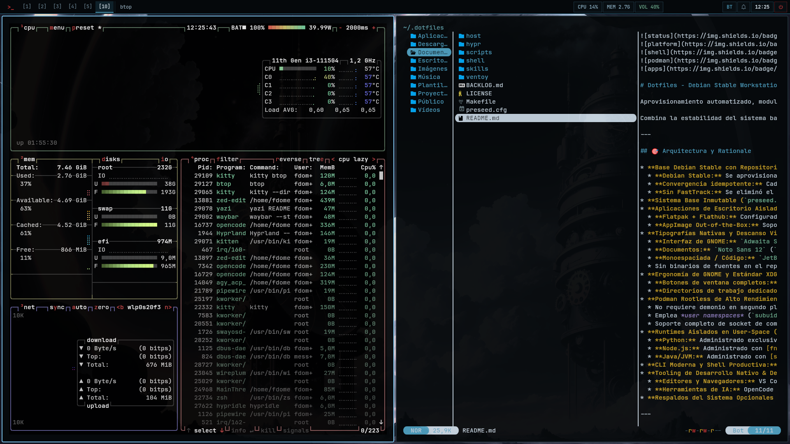

# Dotfiles - Debian Stable Workstation

Aprovisionamiento automatizado, modular e idempotente de una estación de trabajo de alto rendimiento para tareas de **ingeniería de software, DevOps e Inteligencia Artificial**, diseñada exclusivamente para **Debian Stable**. Cada ejecución converge el sistema al estado deseado y puede repetirse sin efectos secundarios.

Combina la estabilidad del sistema base con capas modernas desacopladas: **Backports** (en Stable), **Flatpak + Flathub**, soporte nativo para **AppImage** y contenedores **Podman Rootless** (`crun` + `pasta`/`passt`). Incluye además un **perfil opcional Hyprland** (`make hyprland`) que convive con GNOME sin reemplazarlo.

---



*Perfil Hyprland con Waybar, `yazi` y `btop` sobre el wallpaper de Mr. Robot.*

---

## 🎯 Arquitectura y Rationale

* **Base Debian Stable con Repositorios Extendidos:**
  * **Debian Stable:** Se aprovisiona con soporte extendido para kernels recientes vía **Debian Backports** (`stable-backports`), manteniendo la estabilidad de la base del sistema. El aprovisionamiento está diseñado y validado para **Debian Stable**; Testing/Forky no está soportado y el perfil Hyprland rechaza explícitamente sistemas que no sean Stable.
  * **Convergencia idempotente:** Cada ejecución de `make install` o `make host` deja Backports en su estado canónico (formato DEB822, `Signed-By` correcto y suite `stable-backports`), corrigiendo desviaciones sin duplicar configuración.
  * **Sin FastTrack:** Se eliminó el repositorio FastTrack del aprovisionamiento: ningún paquete lo requería y su presencia rompía la resolución de APT en suites no estables. Si un host conserva `/etc/apt/sources.list.d/debian-fasttrack.sources`, `make host` lo elimina automáticamente.
* **Sistema Base Inmutable (`preseed.cfg`):** Instalación desatendida con particionado GPT + EFI + EXT4 monolítico (`noatime,commit=60`), memoria comprimida ultra-rápida vía `systemd-zram-generator` (`zstd`, prioridad 100) respaldada por swapfile de 4 GB, microcódigo y firmware oficial completo para hardware **AMD e Intel** (CPU, GPU Vulkan/VA-API, Wi-Fi `iwlwifi`/`realtek`/`atheros`, audio SOF) y entorno mínimo `gnome-core`.
* **Aplicaciones de Escritorio Aisladas (Flatpak & AppImage):**
  * **Flatpak + Flathub:** Configurado de forma nativa (`gnome-software-plugin-flatpak`, `xdg-desktop-portal-gnome` y remote `flathub`) para aislar completamente las aplicaciones de consumo general del sistema base.
  * **AppImage Out-of-the-Box:** Soporte FUSE 2 y FUSE 3 garantizado mediante `libfuse2t64` y `fuse3`, con directorio dedicado `~/Aplicaciones` integrado directamente en el `$PATH` del usuario.
* **Tipografías Nativas y Descanso Visual:**
  * **Interfaz de GNOME:** `Adwaita Sans 11` (tipografía oficial predeterminada de GNOME, limpia y balanceada; descargada automáticamente a `~/.local/share/fonts` desde el upstream oficial de GNOME al no estar empaquetada en repositorios de Debian).
  * **Documentos:** `Noto Sans 12` (`fonts-noto-core`, excelente legibilidad para lectura de documentación).
  * **Monoespaciada / Código:** `JetBrains Mono 11` (`fonts-jetbrains-mono`, diseñada específicamente para programadores y descanso visual) con fallback a `Fira Code` (`fonts-firacode`).
  * Sin binarios de fuentes en el repo git: provistas por paquetes APT oficiales y descargas limpias en espacio de usuario.
* **Ergonomía de GNOME y Estándar XDG:**
  * **Botones de ventana completos:** Configura minimizar, maximizar y cerrar en la barra de títulos (`org.gnome.desktop.wm.preferences button-layout 'appmenu:minimize,maximize,close'`).
  * **Directorios de trabajo dedicados:** Crea y registra `~/Proyectos` (`XDG_PROJECTS_DIR`) y `~/Aplicaciones` (`XDG_APPLICATIONS_DIR`) en `~/.config/user-dirs.dirs`, con aliases rápidos en Zsh (`pdir` y `adir`).
* **Podman Rootless de Alto Rendimiento:** Motor de contenedores OCI sin demonio (daemonless) ejecutándose en espacio del usuario:
  * No requiere demonio en segundo plano (`dockerd`) ni privilegios de superusuario (`sudo`).
  * Emplea *user namespaces* (`subuid`/`subgid`), runtime OCI rápido **`crun`** y el motor de red de alto rendimiento **`pasta` (`passt`)** preconfigurado en `~/.config/containers/containers.conf`.
  * Soporte completo de socket de compatibilidad Docker vía `systemd --user` (`podman.socket`) y aliases de conveniencia (`docker`, `d`, `podman compose`, `dc`).
* **Runtimes Aislados en User-Space (PEP 668 Compliant):**
  * **Python:** Administrado exclusivamente con [uv](https://astral.sh/uv) (rápido, compatible con PEP 668 y sin riesgo de corromper paquetes de Debian).
  * **Node.js:** Administrado con [fnm](https://github.com/Schniz/fnm) (Fast Node Manager escrito en Rust).
  * **Java/JVM:** Administrado con [sdkman](https://sdkman.io).
* **CLI Moderna y Shell Productiva:** `ripgrep` (`rg`), `fd-find` (`fd`), `fzf`, `bat`, `btop`, `direnv` y `wl-clipboard`, gestor de archivos en terminal [yazi](https://github.com/sxyazi/yazi) (con previews Sixel en Foot y wrapper `y`), más `zoxide` (`z`/`zi`), `atuin` (historial con `Ctrl+R`), `starship` (prompt) y `tmux` (sesiones persistentes, `Super+Shift+Return`).
* **Tooling de Desarrollo Nativo & DevAI:**
  * **Editores y Navegadores:** VS Code (con repositorio oficial APT DEB822 de Microsoft), Zed editor, Neovim (editor extensible en terminal con lazy.nvim, LSP y Treesitter), Google Chrome oficial.
  * **Herramientas de IA:** OpenCode CLI, Antigravity IDE (Core 2.0 en `/opt`) y Antigravity CLI (`agy` / `antigravity-cli`).
* **Respaldos del Sistema Opcionales (`make timeshift`):** Deja preconfigurado `/etc/timeshift/timeshift.json` (modo RSYNC en EXT4 o BTRFS, excluyendo `/home`, `/swapfile` y cachés de contenedores) sin forzar snapshots automáticos iniciales.

---

## 💿 Fase 0: Instalación Desatendida de Debian (`preseed.cfg`)

El archivo [`preseed.cfg`](preseed.cfg) automatiza la instalación limpia de Debian Stable. Por seguridad, las credenciales sensibles están parametrizadas con placeholders:

1. **Reemplazar placeholders locales antes de inyectar en el instalador/USB:**
   * `<WIFI_SSID>` y `<WIFI_PASSWORD>`: Nombre y clave WPA de tu red Wi-Fi.
   * `<PASSWORD_HASH_SHA512>`: Hash de tu contraseña de usuario generado con:
     ```bash
     openssl passwd -6
     ```
   * En `preseed.cfg`, la suite de instalación está fijada en `stable`.

---

## 🚀 Fase 1: Post-Instalación Rápida (One-Command)

En una instalación limpia de Debian ejecutar:

```bash
sudo apt update && sudo apt install -y git make && \
rm -rf ~/.dotfiles && \
git clone https://github.com/fdomerlo/dotfiles.git ~/.dotfiles && \
cd ~/.dotfiles
make help
```

---

## 📂 Estructura del Repositorio

```text
~/.dotfiles/
├── Makefile                       # Orquestador modular (install, update, host, devai, etc.)
├── BACKLOG.md                     # Pendientes y próximos lotes de productividad
├── preseed.cfg                    # Instalador desatendido Debian Stable (AMD/Intel)
│
├── assets/                        # Capturas usadas en la documentación
│   └── hyprland-desktop.png       #   Vista previa del perfil Hyprland
│
├── host/                          # Configuración del sistema base (requiere sudo)
│   ├── podman.sh                  #   Configuración de Podman Rootless (crun, pasta) y socket (usuario)
│   ├── setup.sh                   #   Configuración de APT (Backports), base y podman
│   └── timeshift.sh               #   Configuración opcional de snapshots Timeshift
│
├── hypr/                          # Perfil opcional Hyprland (no reemplaza GNOME)
│   ├── hyprland.conf              #   Entrada principal; incluye conf/*.conf
│   ├── conf/                      #   env, monitors, workspaces, appearance, keybinds, windowrules, autostart
│   ├── hypridle.conf              #   Bloqueo y apagado de pantalla por inactividad
│   ├── hyprlock.conf              #   Pantalla de bloqueo
│   ├── foot/                      #   Emulador de terminal Wayland (foot.ini)
│   ├── fuzzel/                    #   Lanzador y selector dmenu nativo (fuzzel.ini)
│   ├── swappy/                    #   Anotador rápido de capturas (config)
│   ├── swaync/                    #   Centro de notificaciones (config.json + style.css)
│   ├── scripts/                   #   wallpaper, workspaces, screenshots, portapapeles, scratchpad, atajos y OSD
│   ├── waybar/                    #   Barra (config.jsonc + style.css)
│   └── xdg-desktop-portal/        #   Portal específico de Hyprland (hyprland-portals.conf)
│
├── scripts/                       # Instaladores y configuración de usuario
│   ├── antigravity.png            #   Icono oficial para el lanzador .desktop
│   ├── apt-maintenance.sh         #   Higiene APT (podman-only, DEB822, deduplicación y keyrings)
│   ├── clean-system.sh            #   Limpieza profunda post-upgrade (purga rc, huérfanos, cachés y logs)
│   ├── desktop.sh                 #   Tipografías, botones ventana, carpetas Proyectos/Aplicaciones y GNOME
│   ├── devai.sh                   #   Instalador de OpenCode CLI, Antigravity CLI y Core/IDE
│   ├── devtools.sh                #   Instalador de gh (binario oficial), uv, fnm, sdkman, yazi y mc
│   ├── hyprland.sh                #   Instalador del perfil opcional Hyprland (solo Debian Stable)
│   ├── hyprland-refresh.sh        #   Re-sincroniza configs/scripts desde el repo y recarga la sesión
│   ├── ohmyzsh.sh                 #   Instalación de Zsh, Oh My Zsh y plugins
│   ├── setup_agy.sh               #   Despliegue atómico de Antigravity Core/IDE en /opt (opcional)
│   ├── setup_gh.sh                #   Configuración y autenticación SSH con GitHub CLI
│   ├── setup_git.sh               #   Configuración idempotente de identidad global de Git
│   ├── tooling.sh                 #   Instalación de VS Code (APT DEB822), Chrome (.deb), Zed y Neovim
│   ├── update.sh                  #   Actualización idempotente (only-upgrade incl. Hyprland + self-updates + flatpak)
│   └── verify.sh                  #   Diagnóstico y validación post-instalación
│
└── shell/                         # Dotfiles y utilitarios de línea de comandos
    ├── atuin.toml                 #   Historial de comandos (Atuin)
    ├── btop/                      #   Config base y tema neutro de btop
    │   ├── btop.conf              #     Semilla de configuración (copia única)
    │   └── themes/neutral.theme   #     Paleta de acero/grises, fondo transparente
    ├── nvim/                      #   Configuración modular de Neovim (init.lua, lazy.nvim, LSP, Treesitter)
    │   ├── init.lua               #     Bootstrap de lazy.nvim y carga de módulos
    │   └── lua/                   #     options, keymaps, autocmds y plugins declarativos
    ├── yazi/                      #   Gestor de archivos en terminal
    │   ├── yazi.toml              #     Layout de tres paneles, previews y openers
    │   ├── keymap.toml            #     Atajos F2/F5/F6/F7/F8, pestañas y navegación
    │   └── theme.toml             #     Paleta Nord de alto contraste para lectura
    ├── mc/                        #   Midnight Commander (alternativa de dos paneles)
    │   ├── ini                    #     Config base: skin Nord y sin autoguardado
    │   ├── mcedit.desktop         #     Override para ocultar el editor duplicado en fuzzel
    │   └── skins/nord.ini         #     Skin truecolor Nord (misma paleta que Yazi)
    ├── zathura/                   #   Visor de documentos PDF minimalista (zathurarc)
    ├── lazydocker/                #   TUI de contenedores Podman/Docker (config.yml + .desktop)
    ├── devctl                     #   CLI de diagnóstico, actualización y limpieza
    ├── gitconfig                  #   Configuración global ergonómica de Git
    ├── starship.toml              #   Prompt minimalista de una línea (directorio + Git)
    ├── tmux.conf                  #   Sesiones y splits de tmux
    └── zshrc                      #   Configuración Zsh con uv, fnm, sdkman, fzf, direnv, XDG y Podman
```

---

## 🛠️ Makefile Targets

| Target | Descripción |
| :--- | :--- |
| `make install` | Aprovisionamiento completo (host + podman + shell + devtools + tooling + devai + desktop) |
| `make update` | Actualización idempotente (higiene APT + only-upgrade incl. perfil Hyprland + user-space + flatpak, sin tocar SSH/`gh auth`) |
| `make refresh` | Re-sincroniza configs/scripts de Hyprland desde el repo y recarga Hyprland, Waybar, swaync e hypridle (sin instalar paquetes) |
| `make host` | Configura APT (Backports), CLI moderna, AppImage, Flatpak y Podman |
| `make timeshift` | *(Opcional)* Instala y configura `/etc/timeshift/timeshift.json` sin crear snapshots iniciales |
| `make podman` | Configura Podman en modo Rootless con backend pasta (systemd --user) |
| `make shell` | Instala Zsh, Oh My Zsh, plugins y enlaza `.zshrc`, `.gitconfig`, `devctl`, `btop`, `yazi` y `nvim` |
| `make devtools` | Instala `gh`, `uv`, `fnm`, `sdkman`, `yazi`, prepara SSH con GitHub e identidad Git |
| `make gitconfig` | Configura `user.name` y `user.email` en Git (idempotente e interactivo) |
| `make github-auth` | Flujo interactivo oficial de autenticación en GitHub CLI (`gh auth login`) |
| `make tooling` | Instala navegadores y editores nativos (VS Code, Chrome, Zed, Neovim) |
| `make devai` | Instala OpenCode CLI, Antigravity CLI y despliega Antigravity Core/IDE (opcional) |
| `make desktop` | Aplica tipografías, botones de ventana (min/max/close), directorios de trabajo y extensiones GNOME |
| `make hyprland` | *(Opcional)* Instala y configura el perfil Hyprland sin reemplazar GNOME (solo Debian Stable) |
| `make verify` | Ejecuta el test integral de salud del sistema |
| `make clean` | Limpia paquetes residuales de APT y directorios temporales |
| `make clean-deep` | Limpieza profunda post-upgrade: purga configs residuales (`rc`), dependencias huérfanas, journals y cachés |

---

## 🪟 Perfil opcional Hyprland

`make hyprland` instala un escritorio Wayland completo **sin reemplazar GNOME** y **solo sobre Debian Stable**. GNOME sigue siendo el entorno predeterminado y puede elegirse en GDM en cualquier momento.

```bash
make host       # asegura Backports de Stable (requerido)
make hyprland   # instala el stack e enlaza la configuración
```

El script aborta si el sistema no es Debian Stable o si falta `/etc/apt/sources.list.d/debian-backports.sources`.

### Componentes

| Función | Paquete / Herramienta |
| :--- | :--- |
| Compositor | `hyprland` (desde `stable-backports`) |
| Barra | `waybar` |
| Lanzador | `fuzzel` (nativo Wayland, tematizado en `mr-robot` y `cyber-teal`) |
| Notificaciones | `sway-notification-center` (`swaync`) con historial y No molestar |
| OSD | `swayosd` para volumen y brillo (respaldo directo con `wpctl`/`brightnessctl`) |
| Idle / bloqueo | `hypridle` + `hyprlock` |
| Wallpaper | `swaybg` (con rotación vía `wallpaper.sh`) |
| Agente polkit | `hyprpolkitagent` |
| Keyring / Secretos | `gnome-keyring` + `seahorse` |
| Portales | `xdg-desktop-portal-hyprland` + `xdg-desktop-portal-gtk` (fallback) |
| Capturas y anotación | `grim` + `slurp` + `swappy` |
| Visores nativos | `zathura` + `zathura-pdf-poppler` (PDFs) + `imv` (imágenes Wayland) |
| Portapapeles | `wl-clipboard` + `cliphist` |
| Audio / brillo / media | `wpctl` (PipeWire/WirePlumber), `brightnessctl`, `playerctl` |
| Terminal / archivos | `foot` (con `foot --server`) / `nautilus` (gráfico) + `yazi` (terminal, Sixel vía `chafa`) + `mc` |
| Contenedores / Sysadmin | `lazydocker` (TUI sobre socket Podman), `remmina` (RDP/VNC), `wireshark` (sin root), OpenVPN (`network-manager-openvpn`) |
| Suite Flatpak | `Firefox` (navegador predeterminado), `DBeaver Community`, `Bruno`, `Obsidian`, `Super Productivity` |
| Previews de Yazi | `fd-find` (como `fd`), `7zip`, `ffmpeg`, `chafa`, `poppler-utils`, `jq` |
| Tema | JetBrains Mono, Fira Code, Noto, iconos del sistema (GNOME/KDE), cursor Adwaita, `qt6ct` |

En Stable, `hyprland`, `hypridle`, `hyprlock`, `hyprpolkitagent` y `xdg-desktop-portal-hyprland` se instalan con `-t stable-backports`; el resto proviene de Stable main.

### Atajos principales

| Atajo | Acción |
| :--- | :--- |
| `Super+Return` | Terminal (`foot`) |
| `Super+Shift+Return` | Terminal con `tmux` (sesión `main` persistente) |
| `Super` | Abrir/cerrar el lanzador (`fuzzel`) |
| `Super+D` / `Super+Space` | Lanzador de aplicaciones (`fuzzel`, alterna) |
| `Super+E` | Gestor de archivos gráfico (`nautilus`) |
| `Super+Y` | Gestor de archivos en terminal (`yazi` en `foot`) |
| `Super+W` | Cambiar el wallpaper (aleatorio, sin repetir el actual) |
| `Super+Q` | Cerrar ventana |
| `Super+F` | Pantalla completa |
| `Super+M` | Maximizar / restaurar |
| `Super+Shift+Space` | Alternar flotante |
| `Super+L` | Bloquear sesión (`hyprlock`) |
| `Alt+Tab` / `Alt+Shift+Tab` | Siguiente / anterior ventana |
| ``Alt+` `` | Volver a la ventana anterior |
| ``Super+` `` | Abrir/cerrar scratchpad (terminal flotante) |
| ``Super+Shift+` `` | Mover la ventana actual al scratchpad |
| `Super+G` | Crear/deshacer grupo de ventanas |
| `Super+Tab` / `Super+Shift+Tab` | Ciclar ventanas del grupo |
| `Super+Ctrl+G` / `Super+Shift+G` | Mover ventana al grupo / sacarla del grupo |
| `Super+N` / `Super+Shift+N` | Centro de notificaciones / No molestar |
| `Super+Shift+T` | Intercambiador de temas (Mr. Robot / Cyber-Teal) |
| `Super+F1` | Cheatsheet de atajos activos |
| `Super+V` / `Super+Shift+V` | Historial de portapapeles (`cliphist` + `fuzzel`, alterna) |
| `Print` | Captura de región + anotación rápida en `swappy` + portapapeles |
| `Ctrl+Print` | Captura de región directa a archivo + portapapeles (sin abrir `swappy`) |
| `Shift+Print` | Captura de pantalla completa a archivo + portapapeles |
| `Super+1..0` / `Super+Shift+1..0` | Ir al workspace / mover ventana sin seguirla (también con el teclado numérico); `1-5` en el primer monitor y `6-0` en el segundo |
| `Super+Av.Pág` / `Super+Re.Pág` | Ciclar al workspace siguiente/anterior del monitor (con wrap) |
| `Super+Shift+Av.Pág` / `Super+Shift+Re.Pág` | Mover la ventana al workspace siguiente/anterior del monitor (con wrap) |
| `Super+flechas` / `Super+Shift+flechas` | Foco / mover ventana |
| `Super+Ctrl+flechas` | Redimensionar ventana |
| `XF86Audio*` / `XF86MonBrightness*` | Volumen, mute, multimedia y brillo (con OSD) |

#### Yazi (terminal)

`Super+Y` abre Yazi en Foot. Los atajos tipo GUI se suman a los nativos (`hjkl`, `s`, `S`, `d`, `r`, `w`, `t t`, `o`/`O`).

| Atajo | Acción |
| :--- | :--- |
| `Enter` | Entrar al directorio o abrir el archivo |
| `F3` | Abrir con el opener por defecto (Zed para carpetas) |
| `F4` | Abrir con... (elige entre Neovim, nano, Zed, VS Code) |
| `F2` | Renombrar (cursor antes de la extensión) |
| `F5` / `F6` / `p` | Copiar / cortar / pegar |
| `F7` / `Ctrl+N` | Nueva carpeta / nuevo archivo |
| `F8` / `d` | Mover a la papelera |
| `Ctrl+T` / `Ctrl+W` | Nueva pestaña / cerrar pestaña |
| `Alt+Left` / `Alt+Right` / `Alt+Up` | Atrás / adelante / carpeta padre |
| `s` / `S` | Buscar por nombre (`fd`) / por contenido (`rg`) |
| `z` / `Z` | Saltar con `fzf` / con `zoxide` |
| `Ctrl+H` / `Ctrl+L` | Mostrar u ocultar ocultos / ir a una ruta |
| `Espacio` / `v` / `r` | Seleccionar / modo visual / renombrado masivo |
| `m s` / `m m` | Ver tamaño / fecha de modificación |
| `w` | Gestor de tareas (copias, movimientos, extracciones) |

#### Midnight Commander (terminal)

Alternativa clásica de dos paneles. Se abre escribiendo `mc` en cualquier terminal. Usa el skin Nord (`shell/mc/skins/nord.ini`) y el editor interno.

| Atajo | Acción |
| :--- | :--- |
| `F3` / `F4` | Ver / editar con el editor interno |
| `F5` / `F6` / `F8` | Copiar / mover / borrar |
| `F7` / `Alt+F7` | Crear directorio / buscar archivos |
| `F9` / `F10` | Menú superior / salir |
| `Alt+.` | Mostrar u ocultar archivos ocultos |
| `Tab` / `Insert` | Cambiar de panel / seleccionar |
| `Ctrl+O` | Mostrar la terminal y volver |

### Sesión, portal y theming

* **Display manager:** GDM detecta automáticamente `/usr/share/wayland-sessions/hyprland.desktop`. No se instala `sddm`, `greetd` ni `uwsm`.
* **Agente polkit:** `hyprpolkitagent` se inicia desde `autostart.conf` solo dentro de Hyprland; no se habilita globalmente para no interferir con el agente de GNOME.
* **Waybar:** se lanza con `hypr/scripts/start-waybar.sh`, que espera los sockets IPC de Hyprland antes de iniciar la barra para evitar la carrera de arranque de `exec-once`. El `waybar.service` que Debian habilita por defecto se enmascara porque `graphical-session.target` lo arranca en GNOME, donde falla al no existir `wlr-layer-shell`.
* **Iconos de Waybar:** `style.css` usa `Symbols Nerd Font` para los glifos de los módulos. Debian no empaqueta Nerd Fonts, así que `scripts/hyprland.sh` descarga el release oficial `NerdFontsSymbolsOnly` en `~/.local/share/fonts` si la fuente no está presente. Sin ella los iconos se ven como cuadros.
* **Screen sharing:** `xdg-desktop-portal-hyprland` provee `hyprland.portal` con `UseIn=Hyprland`, por lo que se selecciona solo dentro de la sesión. `xdg-desktop-portal-gtk` cubre el file picker y aplicaciones GTK.
* **`XDG_CURRENT_DESKTOP`:** se define como `Hyprland:GNOME` en `env.conf` de forma intencional, para que los portales de GNOME cubran file picker y secretos. Por eso `appearance.conf` activa `misc:disable_xdg_env_checks`, que silencia el aviso de Hyprland sobre entornos «gestionados externamente».
* **Portal (`hyprland-portals.conf`):** como `XDG_CURRENT_DESKTOP` incluye `GNOME`, `xdg-desktop-portal` intentaba usar `gnome.portal` para las interfaces que `hyprland.portal`/`gtk.portal` no implementan. Ese backend no existe en Hyprland y el portal quedaba bloqueado esperando timeouts de D-Bus; como consecuencia `org.freedesktop.portal.Settings` no respondía y Waybar se quedaba esperando el esquema de color sin dibujarse. `hypr/xdg-desktop-portal/hyprland-portals.conf` fija `default=hyprland;gtk`, mantiene `Secret=gnome-keyring` y desactiva con `none` las interfaces exclusivas de GNOME. El nombre `hyprland-portals.conf` es intencional: xdg-desktop-portal solo lo aplica cuando `XDG_CURRENT_DESKTOP` contiene `Hyprland`; en GNOME usa `gnome-portals.conf` del sistema. Un `portals.conf` genérico también se aplicaba en GNOME y hacía que sus apps (Nautilus, Calculadora, Text Editor) esperaran timeouts de los backends equivocados.
* **Ciclo de sesión:** `autostart.conf` inicia `graphical-session.target` y lo detiene con `exec-shutdown`. Los portales son `PartOf` de ese target, así que no sobreviven a un cambio Hyprland → GNOME con un entorno obsoleto.
* **Teclado:** layout `latam` (`pc105`), consistente con `preseed.cfg`.
* **Cursor:** `Adwaita` 24 px en Hyprland, XWayland, GTK y Qt, el mismo que usa GNOME. `env.conf` fija `XCURSOR_THEME`/`HYPRCURSOR_THEME`, `settings.ini` de GTK fija `gtk-cursor-theme-name` y `scripts/desktop.sh` converge `gsettings`. Así no se mezclan temas entre ventanas nativas y aplicaciones GTK/Electron. Tras cambiar `env.conf` hace falta reiniciar la sesión de Hyprland; `hyprctl setcursor Adwaita 24` lo aplica en caliente al compositor.
* **Monitores:** `hypr/conf/monitors.conf` fija un layout de dos pantallas por nombre de conector (no por modelo/serie): `HDMI-A-1` a la izquierda en `0x0` y `HDMI-A-2` a la derecha con `auto-right`. La referencia de tamaño de texto es el panel interno de la ThinkPad E15 Gen 2 (15.6" 1080p, ~141 PPI) a escala `1.0`; el monitor de 24" 1080p (~92 PPI) usa `0.6667` (2/3), que es `92.4 / 141` y deja el texto con el mismo tamaño físico que en la notebook. Se mantiene `monitor = ,preferred,auto,1` como fallback para salidas desconocidas. Si en otra PC los conectores se llaman distinto, solo hay que ajustar esas líneas (o intercambiarlas para invertir el orden físico). Ver salidas con `hyprctl monitors`.
* **Escalado por monitor (DPI):** la escala de Hyprland es un zoom lógico por salida, no un ajuste automático de densidad. El tamaño físico del texto depende del PPI lógico (`PPI físico / scale`): dos monitores con la misma escala pero distinto PPI muestran la misma fuente con tamaños físicos distintos. `hypr/scripts/monitor-scale.sh` calcula el PPI de cada salida con `hyprctl monitors -j` y sugiere la escala para igualar el PPI lógico, tomando como referencia el monitor enfocado (`--ref` y `--logical-ppi` permiten cambiarla). Ejemplo con la ThinkPad como referencia: 15.6" 1080p (141 PPI) en `1.0`, 24" 1080p (92 PPI) en `0.6667` y 27" 1440p (109 PPI) en `0.77`. El valor va en el cuarto campo de `monitor = …` en `monitors.conf`. Las escalas menores que 1 son válidas y son la única forma de igualar un panel de PPI alto con uno bajo, a costa de dibujar el texto con menos píxeles físicos (se ve algo más suave); si preferís más nitidez que exactitud, `0.75` deja el texto ~15% más grande y `0.8` ~22%. `foot` respeta esa escala con su `dpi-aware=no` por defecto; `dpi-aware=yes` desacopla la terminal del zoom global y mantiene el tamaño físico del texto al mover la ventana entre monitores, a costa de no coincidir con el resto de la UI. No conviene fijar `GDK_SCALE`, `GDK_DPI_SCALE` ni `QT_SCALE_FACTOR` globales: pisan el escalado por salida.
* **Workspaces:** `hypr/scripts/workspaces-init.sh` (lanzado por `autostart.conf` con `--watch`) asigna **5 workspaces por salida conectada**, en orden izquierda→derecha según su `x`: `1–5` al primero y `6–10` al segundo. Con un solo monitor eso da `1–5` en `eDP-1`; con dos, `1–5` en `HDMI-A-1` y `6–10` en `HDMI-A-2`. Los aplica en caliente con `hyprctl keyword workspace` y `persistent:true`, así Hyprland los mantiene vivos y Waybar muestra solo los de su salida (`all-outputs: false`) sin `persistent-workspaces`. `hypr/conf/workspaces.conf` queda solo como documentación: **no** conviene atar workspaces a un monitor en el config, porque Hyprland reserva esos IDs aunque el monitor esté desconectado (`CMonitor::findAvailableDefaultWS()`) y en la notebook el primer workspace libre terminaba siendo `11`. Para recorrerlos, `Super+Av.Pág`/`Super+Re.Pág` ciclan dentro del monitor enfocado con wrap (`5→1`, `10→6`) mediante `hypr/scripts/workspace-cycle.sh`, que calcula el rango con el mismo criterio; con `Shift` mueve la ventana en vez de cambiar de workspace. La cantidad por monitor se ajusta con `WS_PER_MONITOR` en ambos scripts. Con un solo monitor, `Super+6..0` crea workspaces sueltos fuera del rango: para moverse dentro de la pantalla conviene `Super+1..5` o el ciclo con `Av.Pág`/`Re.Pág`.
* **Wallpaper:** el daemon (`wallpaper.sh --daemon`, arrancado por `autostart.conf`) rota el fondo cada 30 minutos entre los `.png`/`.jpg`/`.webp` de `~/.config/hypr/wallpapers`, `~/Imágenes/Wallpapers` y el repo, sin repetir el actual. `Super+W` envía `SIGUSR1` al daemon para cambiar una sola vez; el bucle distingue la interrupción del `sleep` para no aplicar un segundo cambio. Sin imágenes se usa `swaybg -c '#0c1012'`.
* **Configuración:** los archivos de `hypr/` se enlazan uno por uno en `~/.config/hypr`, `~/.config/waybar`, `~/.config/fuzzel`, `~/.config/foot`, `~/.config/swappy` y `~/.config/swaync`. Si ya existía un archivo real, se conserva como `.bak.<timestamp>`; reejecutar `make hyprland` es idempotente. Los archivos que dependen del tema son symlinks a `hypr/themes/active/…` (ver **Temas**).
* **Notificaciones y OSD:** `swaync` actúa como demonio de notificaciones (historial, No molestar y panel de control). `swayosd-server` muestra el OSD de volumen y brillo; `~/.config/hypr/scripts/osd.sh` cae a `wpctl`/`brightnessctl` si `swayosd` no está presente.
* **Red y reloj:** el estado de red se muestra solo en el módulo `network` de Waybar; no se inicia `nm-applet` para evitar el icono duplicado en la bandeja. Las conexiones nuevas y perfiles VPN (`.ovpn`) se gestionan con `nm-connection-editor` (soporte OpenVPN integrado) o `nmcli`. El reloj muestra solo la hora local (con `locale` y `timezone` explícitos) y la fecha completa en el tooltip.
* **Bluetooth:** el estado se muestra solo en el módulo `bluetooth` de Waybar; no se inicia `blueman-applet` para evitar el icono duplicado en la bandeja. El clic abre `blueman-manager`, y el paquete `blueman` se mantiene instalado.
* **Panel de notificaciones:** `swaync` corre con `keyboard-shortcuts: false` para no quedarse con el teclado/foco, y con `layer-shell-cover-screen: true` para cerrar al hacer clic fuera. Una `layerrule` mantiene Waybar por encima del panel, y el icono de la campana usa `notifications-toggle.sh` con caché de estado. Trade-off: ESC y la navegación por teclado dentro del panel no están disponibles; se cierra con clic en la campana, clic afuera o `Super+N`.
* **Indicadores CPU/MEM:** un clic abre `btop` en `foot`.
* **Audio:** `start-waybar.sh` ejecuta `audio-init.sh` antes de lanzar Waybar. Si WirePlumber arrancó antes que PipeWire y dejó solo `Dummy Output` (carrera conocida con `sof-hda-dsp`), lo reinicia una vez para crear Speaker/HDMI; así el módulo `pulseaudio` sigue el sink real y el volumen responde.
* **Shell:** `shell/zshrc` inicializa `zoxide`, `atuin` y `starship` solo si están instalados, y conserva un prompt nativo mínimo con `vcs_info` como respaldo. El prompt de Starship es de una sola línea (directorio, rama y estado de Git, carácter) para no ocupar espacio vertical. `make shell` enlaza además `~/.config/starship.toml`, `~/.config/atuin/config.toml` y `~/.tmux.conf`.
* **btop:** `make shell` enlaza `shell/btop/themes/neutral.theme` en `~/.config/btop/themes/` y asegura el tema `neutral` en `~/.config/btop/btop.conf`. El tema es monocromático (acero/grises) y usa fondo transparente, así hereda el color de la terminal y no compite con `mr-robot` ni con `cyber-teal`. La config no se enlaza porque btop la reescribe al salir.
* **Yazi:** `make shell` enlaza `shell/yazi/{yazi,keymap,theme}.toml` en `~/.config/yazi/` y crea `~/.local/bin/fd -> /usr/bin/fdfind` (Debian instala `fd-find` con ese nombre). `scripts/devtools.sh` instala `7zip`, `ffmpeg` y `chafa` si faltan para previews de comprimidos, video e imágenes Sixel en Foot. El tema usa una paleta Nord con contraste mínimo de 4.5 : 1 sobre los fondos de `mr-robot` y `cyber-teal`: respeta el fondo de la terminal y reserva los acentos para tipos de archivo, bordes y estados. `s` requiere `fd`, `S` requiere `rg`, los PDF usan `pdftoppm` (y abren con `zathura`) y los JSON usan `jq`. Las carpetas y los archivos de texto usan el primer opener de `edit` en `yazi.toml` (hoy Zed); para abrirlos con otra app, reordená esa lista o usá `F4`. Zed se invoca como `sh -c '"$HOME/.local/bin/zed" %s'` porque Yazi no hereda el `PATH` del login (no incluye `~/.local/bin`) y no expande `$HOME` en los openers. El reparto de columnas se ajusta con `ratio` en `yazi.toml` (hoy `[2, 3, 5]`: padre, lista y preview).
* **Midnight Commander:** `make shell` enlaza `shell/mc/ini` en `~/.config/mc/ini` y `shell/mc/skins/nord.ini` en `~/.local/share/mc/skins/`. El skin usa truecolor y la misma paleta Nord que Yazi (respeta el fondo de la terminal y reserva los acentos por tipo de archivo). `auto_save_setup=false` evita que `mc` reescriba el `ini` enlazado al salir; los cambios se hacen en el repo. `shell/mc/mcedit.desktop` se enlaza en `~/.local/share/applications/` con `NoDisplay=true` para que `fuzzel` muestre solo «Midnight Commander» y no una segunda entrada del editor (F4 sigue abriendo el editor interno). `scripts/devtools.sh` instala `mc` si falta y `scripts/update.sh` lo mantiene actualizado.
* **Neovim:** `make shell` enlaza `shell/nvim` en `~/.config/nvim`. Configuración modular y limpia en Lua con gestor declarativo `lazy.nvim`, tema TokyoNight Night coherente con la paleta oscura de la terminal, análisis sintáctico con `nvim-treesitter`, buscador difuso con `telescope.nvim` (`fzf`/`ripgrep`), integración LSP nativa con `mason.nvim` (`lua_ls`, `bashls`), autocompletado `nvim-cmp` e integración con Git (`gitsigns`). Enlazado automáticamente en `~/.config/nvim`, exportado como `$EDITOR`/`$VISUAL` en Zsh y configurado como opener de terminal en Yazi (`yazi.toml`). `scripts/tooling.sh` instala el binario oficial en espacio de usuario (`~/.local/share/neovim` -> `~/.local/bin/nvim`) o vía APT, y `scripts/update.sh` lo mantiene al día.
* **Fuzzel:** `hypr/fuzzel/fuzzel.ini` apunta al tema activo (`mr-robot` o `cyber-teal`), filtra acciones por `XDG_CURRENT_DESKTOP=Hyprland:GNOME` y se alterna con una sola tecla mediante `hypr/scripts/toggle-menu.sh`.
* **Capturas:** `hypr/scripts/screenshot-region.sh` y `screenshot-full.sh` guardan en `$XDG_PICTURES_DIR/Screenshots`. La sesión de Hyprland no exporta esa variable, así que la resuelven con `xdg-user-dir PICTURES` (que lee `~/.config/user-dirs.dirs`) y caen a `~/Imágenes` si no está: así respetan el directorio en español en vez de crear `~/Pictures`.

### Actualizar y refrescar cambios

`make update` mantiene los paquetes al día, incluidos los del perfil Hyprland (`hyprland`, `waybar`, `fuzzel`, `foot`, `swaync`, `swayosd`, `hypridle`, portales, PipeWire, etc.). Solo actualiza los que estén instalados, así que es seguro ejecutarlo también en equipos sin Hyprland.

Cuando edites configs o scripts en un equipo y los traigas al otro con `git pull`, no hace falta reinstalar el perfil ni cerrar sesión:

```bash
git pull
make refresh
```

`scripts/hyprland-refresh.sh`:

1. Re-enlaza los mismos destinos que `make hyprland` (`hypr/`, `waybar/`, `fuzzel/`, `foot/`, `swappy/`, `swaync/`, portal y wallpapers) en `~/.config`. Si encuentra un archivo real, lo conserva como `.bak.<timestamp>`.
2. Elimina symlinks rotos que apunten al repo (scripts o configs retirados).
3. Recarga `hyprctl`, asegura `workspaces-init.sh --watch`, reinicia Waybar, relee config/CSS de `swaync` y reinicia `hypridle`.
4. Informa errores de `hyprctl configerrors` si los hubiera.

Si solo querés sincronizar archivos sin tocar la sesión activa:

```bash
bash scripts/hyprland-refresh.sh --no-reload
```

`foot`, `fuzzel` e `hyprlock` toman los cambios en su próxima apertura; el resto se aplica al instante. `hypr/themes/active` es estado runtime (gitignored): si no existe, el script lo recrea apuntando a `mr-robot`.

Si `make refresh` se ejecuta desde GNOME, sincroniza los archivos y reinicia `xdg-desktop-portal` para que tome `hyprland-portals.conf` (Hyprland) o `gnome-portals.conf` (GNOME); no intenta recargar Hyprland. Al cerrar Hyprland, `exec-shutdown` detiene `graphical-session.target`, así que los portales no quedan vivos con el entorno de la sesión anterior.

### Temas

Los archivos con variantes visuales viven en `hypr/themes/<tema>/` y los paths clásicos (`hypr/conf/appearance.conf`, `hypr/waybar/*`, `hypr/swaync/style.css`, `hypr/fuzzel/fuzzel.ini`, `hypr/foot/foot.ini` y `hypr/hyprlock.conf`) son symlinks a `hypr/themes/active/…`. Cambiar de tema solo mueve el symlink `active`, así que no se modifican archivos versionados ni queda el working tree sucio.

| Tema | Estilo |
| :--- | :--- |
| `mr-robot` | Negro azulado, bordes acero de 1 px, transparencia pareja, foco solo por borde, acento rojo `fsociety`, reloj con segundos. |
| `cyber-teal` | Glass cian/turquesa, bordes degradados, esquinas redondeadas, blur y sombras. |

```bash
~/.config/hypr/scripts/theme-switch.sh            # tema activo
~/.config/hypr/scripts/theme-switch.sh list       # temas disponibles
~/.config/hypr/scripts/theme-switch.sh menu       # selector con fuzzel
~/.config/hypr/scripts/theme-switch.sh toggle     # alterna al siguiente
~/.config/hypr/scripts/theme-switch.sh mr-robot   # aplica un tema
```

`Super+Shift+T` abre el selector. El script recarga Hyprland, reinicia Waybar y relee el CSS de swaync; `fuzzel`, `foot` e `hyprlock` toman el tema en su próxima apertura. `hypr/themes/active` es estado runtime y está en `.gitignore`; `make hyprland` lo recrea con `mr-robot` si no existe.

Para agregar un tema, crear `hypr/themes/<nombre>/` con la misma estructura (`appearance.conf`, `hyprlock.conf`, `foot/foot.ini`, `fuzzel/fuzzel.ini`, `swaync/style.css`, `waybar/config.jsonc`, `waybar/style.css`) y usar `theme-switch.sh <nombre>`.

### Rollback

1. En GDM, elegir **GNOME** (o **GNOME on Xorg**) y volver a iniciar sesión.
2. Opcionalmente, quitar solo los enlaces creados por el perfil (los archivos propios y backups se conservan):
   ```bash
   find ~/.config/hypr ~/.config/waybar ~/.config/fuzzel ~/.config/foot ~/.config/swappy ~/.config/swaync \
     -maxdepth 2 -type l -lname '*/.dotfiles/hypr/*' -delete 2>/dev/null || true
   sudo apt-get remove --purge hyprland hypridle hyprlock hyprpolkitagent \
       xdg-desktop-portal-hyprland waybar fuzzel foot sway-notification-center grim slurp swappy cliphist swaybg
   ```
3. Restaurar los backups `.bak.<timestamp>` si se habían personalizado archivos previos.

GNOME y el resto del aprovisionamiento no se modifican al instalar o quitar el perfil.

---

## 🧰 CLI `devctl`

`devctl` se instala automáticamente en `~/.local/bin/devctl` como enlace simbólico al repositorio.

```bash
# Diagnóstico integral del sistema, CLI moderna, Podman rootless, zram, Flatpak y AppImage
devctl doctor

# Actualización idempotente de la estación (equivale a `make update`)
devctl update

# Limpieza profunda post-upgrade (equivale a `make clean-deep`)
devctl clean
```

---

## 🧪 Verificación y Diagnóstico

Para validar la integridad de la estación de trabajo en cualquier momento:

```bash
make verify
```

El script comprueba de forma automática:
1. Módulo DRM del kernel para aceleración gráfica (`amdgpu` / `i915` / `xe`).
2. Activación de `zRAM` como swap primario de alta velocidad.
3. Existencia y montaje del `swapfile` secundario en EXT4.
4. Estado de **Timeshift** (informativo/opcional).
5. Estado operativo y modo rootless de **Podman Rootless**.
6. Disponibilidad de tipografías del sistema en Fontconfig (`JetBrains Mono`, `Fira Code`, `Noto Sans`, `Adwaita Sans`).
7. Integridad de los enlaces simbólicos de dotfiles (`~/.zshrc`, `~/.gitconfig`, `devctl`, `~/.config/nvim/init.lua`).
8. Presencia en el `PATH` de los binarios esenciales (`git`, `gh`, `uv`, `fnm`, `code`, `zed`, `nvim`, `antigravity`, `podman`, `yazi`, `mc`).
9. Higiene de repositorios APT (podman-only, sin duplicados) y autenticación de GitHub (SSH y API).
10. Personalizaciones de GNOME (botones de ventana minimizar, maximizar y cerrar).
11. Directorio dedicado de desarrollo (`~/Proyectos` / `XDG_PROJECTS_DIR`).
12. Ecosistema de aplicaciones: Flatpak + Flathub activo, AppImage runtime FUSE y repositorios oficiales de Debian Stable (Backports).
13. Perfil Hyprland (opcional): binarios, agente polkit, sesión en GDM, portal de escritorio, symlinks de configuración y `hyprctl configerrors` cuando la sesión está activa. Si no está instalado, solo informa sin fallar.
