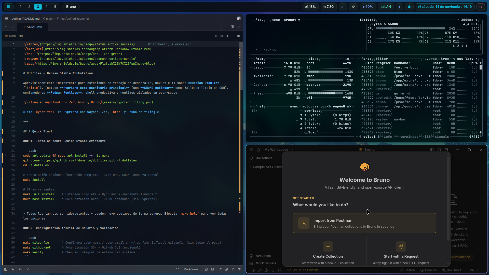

# Dotfiles — Debian Stable Workstation

Aprovisionamiento idempotente para estaciones de trabajo de desarrollo, DevOps e IA sobre **Debian Stable** (`trixie`). Incluye **Hyprland como escritorio principal** (con **GNOME estándar** como fallback limpio en GDM), contenedores **Podman Rootless**, shell productiva y runtimes aislados en user-space.



*Tema `cyber-teal` en Hyprland con Waybar, Zed, `btop` y Bruno en tiling.*

---

## ⚡ Quick Start

### 1. Instalar sobre Debian Stable existente

```bash
sudo apt update && sudo apt install -y git make
git clone https://github.com/fdomerlo/dotfiles.git ~/.dotfiles
cd ~/.dotfiles

# Instalación estándar (estación completa + Hyprland, GNOME como fallback)
make install

# Otras variantes:
make full-install    # Estación completa + Hyprland + snapshots Timeshift
make base-install    # Solo estación base + GNOME estándar (sin Hyprland)
```

> Todos los targets son idempotentes y pueden re-ejecutarse de forma segura. Ejecuta `make help` para ver todas las opciones.

### 2. Configuración inicial de usuario y validación

```bash
make gitconfig       # Configura user.name / user.email en ~/.config/git/local.gitconfig (sin tocar el repo)
make github-auth     # Autenticación SSH + GitHub CLI (opcional)
make verify          # Chequeo integral de estado del sistema
```

### 3. Instalación desatendida desde cero (opcional: `preseed.cfg`)

Para aprovisionar un equipo nuevo con [`preseed.cfg`](preseed.cfg), reemplaza antes en una copia local los placeholders:
- `<WIFI_SSID>` y `<WIFI_PASSWORD>`
- `<PASSWORD_HASH_SHA512>` (generado con `openssl passwd -6`)

---

## 🧰 Qué incluye

| Capa | Herramientas principales |
| :--- | :--- |
| **Escritorio (Hyprland + GNOME fallback)** | `hyprland`, `waybar`, `quickshell` (Lanzador Unificado + Overview/Actividades), `fuzzel`, `foot`, `swaync`, `swayosd`, `hyprlock`/`hypridle`, `grim`+`slurp`+`swappy`, `wf-recorder`, `tesseract-ocr`, temas `cyber-teal` / `mr-robot`, fuentes Debian (`Inter`, `Atkinson Hyperlegible`, `JetBrains Mono`) y cursor `Bibata-Modern-Classic` |
| **Sistema & Contenedores** | Debian Stable + Backports, `zRAM` (`zstd`), Podman Rootless (`crun` + `pasta`, socket Docker-compat), `Timeshift` opcional, Flatpak + Flathub, AppImage (`~/Aplicaciones` en `$PATH`) |
| **Shell & CLI** | Zsh + Oh My Zsh, `starship`, `atuin`, `zoxide`, `tmux`, `ripgrep`, `fd`, `fzf`, `bat`, `btop`, `yazi`, `mc`, `lazydocker`, `direnv`, `devctl` |
| **Runtimes (user-space)** | Python ([uv](https://astral.sh/uv)), Node.js ([fnm](https://github.com/Schniz/fnm)), Java ([sdkman](https://sdkman.io)) |
| **Navegadores, Editores & IA** | Brave (predeterminado + soporte PWA), Google Chrome, Firefox (Flatpak), VS Code, Zed, Neovim (`lazy.nvim`), OpenCode CLI, Antigravity IDE/CLI, DBeaver, Bruno, Remmina, Wireshark, Obsidian, LibreOffice |

---

## 🛠️ Comandos diarios (`Makefile` y `devctl`)

| Comando | Uso |
| :--- | :--- |
| `make install` | Aprovisionamiento completo con Hyprland y GNOME estándar como fallback |
| `make full-install` | Igual que `make install` más configuración de snapshots Timeshift |
| `make base-install` | Estación base sin Hyprland (solo GNOME estándar + CLI/Tooling/Podman) |
| `make hyprland` | Instala o re-aplica solo el stack y la configuración de Hyprland |
| `make hypr-desktop` / `make hypr-laptop` | Aplica plantilla local de desktop o notebook en `~/.config/hypr/conf/local.conf` |
| `make refresh` | Re-enlaza configs/scripts de Hyprland y recarga la sesión activa tras un `git pull` |
| `make update` / `devctl update` | Actualiza paquetes APT (`packages/`), herramientas user-space y Flatpaks |
| `make verify` / `devctl doctor` | Verifica salud del entorno, enlaces, Podman y Hyprland |
| `make clean` / `make clean-deep` | Limpieza estándar o profunda (`rc`, huérfanos, cachés y logs) |
| `devctl webapp install "<Nombre>" "<URL>"` | Crea una Web App (PWA) aislada en Brave con icono e integración en Hyprland |

---

## 🪟 Guía rápida de Hyprland

Tras ejecutar `make install` (o `make hyprland`), elige **Hyprland** en GDM. **GNOME estándar** queda intacto en el selector de sesión como fallback.

### Atajos esenciales

| Atajo | Acción |
| :--- | :--- |
| `Super` / `Super+D` / `Super+Space` | **Centro Unificado** (`Apps`, `Capturar`, `Estilo`, `Sistema`, `Dev & IA` — cambia de pestaña con `Tab`) |
| `Super+A` | **Actividades / Overview** (workspaces + previews en vivo + búsqueda de ventanas abiertas) |
| `Super+F1` | **Cheatsheet interactivo** con todos los atajos activos (teclado + mouse) |
| `Super+Return` / `Super+Shift+Return` | Terminal (`foot`) / terminal con sesión `tmux` persistente |
| `Super+B` / `Super+E` / `Super+Y` | Navegador (`brave-browser`) / archivos (`nautilus`) / `yazi` TUI |
| `Super+` `` ` `` / `Super+Shift+` `` ` `` | Mostrar/ocultar terminal flotante (scratchpad) / enviar ventana al scratchpad |
| `Super+Q` / `Super+F` / `Super+M` / `Super+S` | Cerrar / pantalla completa / maximizar / alternar flotante |
| `Super+1..0` / `Super+Shift+1..0` | Cambiar de workspace / mover ventana (`1–5` monitor 1, `6–0` monitor 2) |
| `Super+Av.Pág` / `Super+Re.Pág` | Ciclar workspaces cubriendo todos los monitores |
| `Super+V` / `Super+Shift+T` / `Super+W` | Historial portapapeles / cambiar tema / siguiente wallpaper |
| `Print` / `Ctrl+Print` / `Shift+Print` | Captura + `swappy` / captura directa al portapapeles / pantalla completa |
| `Super+Shift+R` / `Super+Shift+P` / `Super+Ctrl+O` | Grabar pantalla / selector color HEX / OCR de región |
| `Super+L` / `Super+N` / `Super+Ctrl+N` | Bloquear pantalla / notificaciones / luz nocturna (`4000K`) |
| **Touchpad (3 dedos)** | Horizontal: workspaces · Arriba: Centro Unificado · Abajo: Actividades |

### Temas y wallpapers

```bash
~/.config/hypr/scripts/theme-switch.sh toggle     # Alterna entre cyber-teal y mr-robot
~/.config/hypr/scripts/theme-switch.sh menu       # Selector interactivo (Super+Shift+T)
```

- **`cyber-teal`:** estética glass redondeada con blur, sombras, tipografía `Inter` en UI y wallpaper por defecto [`northern-lights.jpg`](hypr/themes/cyber-teal/wallpapers/northern-lights.jpg).
- **`mr-robot`:** estilo terminal plano con bordes acero, Smart Gaps sin márgenes con una sola ventana, tipografía `JetBrains Mono` y wallpaper por defecto [`cyber-tower.jpg`](hypr/themes/mr-robot/wallpapers/cyber-tower.jpg).
- **Wallpapers propios:** coloca imágenes en `~/.config/hypr/wallpapers/` y, si querés agruparlas por tema, en `~/.config/hypr/wallpapers/<tema>/`. Ambas carpetas se suman al pool de rotación; rota con `Super+W`.

### Personalización local (sin ensuciar Git)

- **Git:** `~/.config/git/local.gitconfig` (`user.name`, `user.email`, firma, etc.).
- **Hyprland por equipo:** `~/.config/hypr/conf/local.conf` (monitores, sensibilidad, binds locales; inicializado con `make hypr-desktop` / `make hypr-laptop`).
- **Waybar:** `~/.config/waybar/local.jsonc` (módulos o formato por equipo).
- **Paquetes:** edita los manifiestos en [`packages/`](packages/) si haces un fork para tu equipo.

### Rollback a GNOME

Hyprland no modifica tu sesión GNOME: basta con elegir **GNOME** en GDM. Si además quieres quitar los symlinks del escritorio Hyprland:

```bash
find ~/.config/hypr ~/.config/waybar ~/.config/fuzzel ~/.config/foot ~/.config/quickshell ~/.config/swappy ~/.config/swaync ~/.config/fontconfig/conf.d \
  -maxdepth 2 -type l -lname '*/.dotfiles/hypr/*' -delete 2>/dev/null || true
```

---

## 📂 Estructura del repositorio

```text
~/.dotfiles/
├── Makefile          # Orquestador de instalación, actualización y perfiles
├── preseed.cfg       # Instalador desatendido de Debian Stable
├── packages/         # Listas declarativas de paquetes (apt, backports, flatpak, externos)
├── host/             # Configuración del sistema base y Podman Rootless
├── scripts/          # Instaladores modulares, actualización (update.sh) y salud (verify.sh)
├── shell/            # Dotfiles de zsh, git, tmux, nvim, yazi, mc, btop, zathura y CLI devctl
└── hypr/             # Escritorio Hyprland (conf, quickshell, waybar, foot, fuzzel, swaync, temas, scripts)
```
